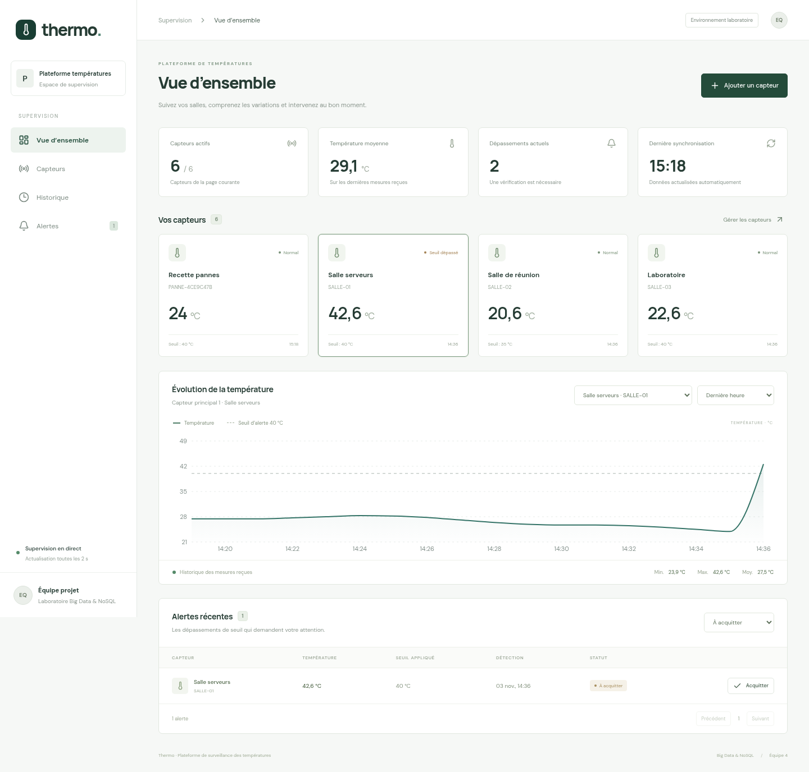
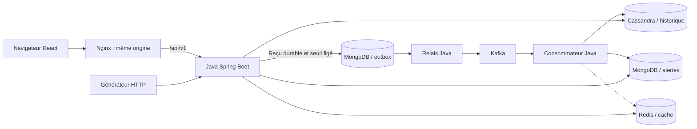
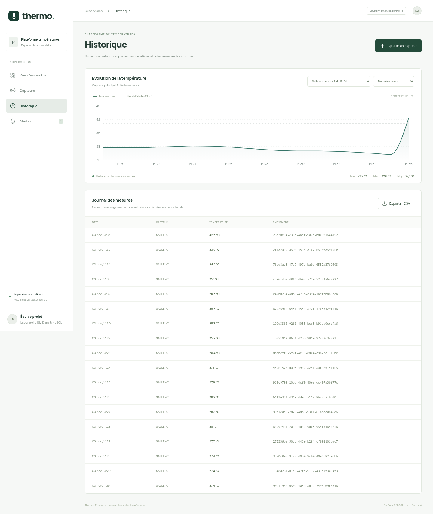
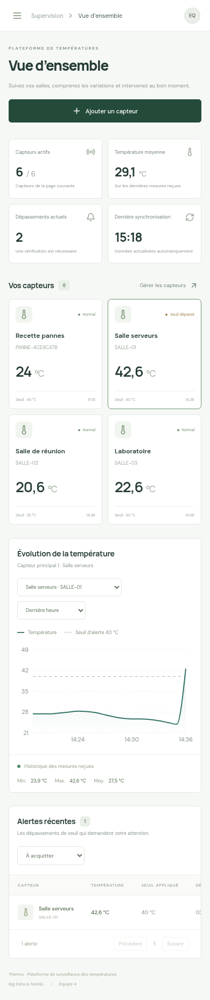

# Thermo · Plateforme Big Data & NoSQL

Une plateforme de surveillance des températures de salles : collecte continue, historique consultable, dernières valeurs et alertes de dépassement. Le projet associe **Java Spring Boot, React, Kafka, MongoDB, Cassandra et Redis**, avec Docker Compose pour l’exécution et Ansible pour préparer le déploiement sur deux VM Ubuntu.



## Le projet

L’objectif est de rendre le déploiement d’une plateforme de données reproductible depuis un poste Linux. Une mesure envoyée par un capteur simulé doit traverser le flux, être historisée, actualiser la dernière température et produire une alerte si son seuil est dépassé. Le tableau de bord rend ce parcours visible.

L’infrastructure comme code, le versionnement, les volumes persistants et les tests de reprise répondent aux risques d’une installation manuelle : configuration différente d’un poste à l’autre, mauvais listener Kafka, perte de données à la recréation d’un conteneur ou service démarré mais inutilisable.

La maquette illustre une ingestion continue et plusieurs modèles NoSQL. Un générateur de quelques mesures par seconde démontre le fonctionnement ; il ne constitue pas un benchmark de passage à l’échelle. Chaque service de données possède une seule instance.

## Fonctions

- Tableau de bord actualisé toutes les deux secondes, valeurs courantes et dépassements de seuil.
- Création, consultation, modification et désactivation des capteurs avec protection contre les modifications concurrentes.
- Admission durable des mesures, suivi des états de publication et de traitement.
- Historique par période, pagination signée, courbe et export CSV des lignes chargées.
- Minimum, maximum et moyenne sur une période bornée.
- Alertes avec seuil figé à l’admission et acquittement idempotent.
- Générateur indépendant et jeu de démonstration envoyés par HTTP.
- Reprises après panne, cache facultatif, DLQ et rejeu explicite des ingestions en échec.

## Démarrer avec Docker

Prérequis : Linux ou environnement compatible Bash/Python 3, Git, Docker Engine et Compose v2, `curl`. Prévoir environ **8 Go de RAM disponibles pour la pile locale**, davantage pour construire les images confortablement, ainsi que plusieurs Go de disque. Cassandra peut prendre plusieurs minutes au premier lancement.

```bash
git clone https://github.com/HACKER2025998/Platforme-Big-Data-NoSql.git
cd Platforme-Big-Data-NoSql
git switch develop
./scripts/dev-up.sh
```

Le script génère les secrets manquants dans `.env`, construit les images, prépare les schémas et attend la disponibilité de Java. Il conserve les valeurs privées existantes.

| Accès local | Adresse |
| --- | --- |
| Interface | **http://localhost:8088** |
| API | http://localhost:8080/api/v1 |
| Liveness privée | http://localhost:8080/actuator/health/liveness |
| Readiness privée | http://localhost:8080/actuator/health/readiness |

L’interface commence vide. Créer un capteur depuis **Capteurs**, puis utiliser **Envoyer une mesure**, ou charger la démonstration :

```bash
python3 scripts/demo.py
# 4 salles, 200 mesures historiques, dont un dépassement de seuil.
# Attendre quelques secondes pour le traitement asynchrone.

python3 scripts/generate-measures.py --seed --count 10
# Ctrl+C pour arrêter le générateur ; les données restent conservées.

./scripts/dev-down.sh       # arrête les conteneurs, conserve les volumes
```

Aucun mot de passe commun n’est livré. Les identifiants techniques et secrets générés restent dans `.env` sur votre poste ; ce fichier n’est jamais publié. Voir [la configuration et l’exploitation](docs/exploitation.md).

## Architecture et circulation des données



Le relais, le consommateur, les contrôleurs et les services métier appartiennent au **même backend Spring Boot**, déployé dans un seul conteneur. Le navigateur passe par Nginx et n’accède jamais directement aux bases.

| Service | Usage réel |
| --- | --- |
| MongoDB | Fiches des capteurs, reçu/outbox immuable par événement et documents d’alerte |
| Kafka KRaft | Flux durable `mesures-temperature`, clé par capteur ; topic DLQ séparé |
| Cassandra | Historique partitionné par capteur et jour UTC ; dernière mesure durable |
| Redis | Cache de dernière valeur, mise à jour atomique et repli sur Cassandra |
| Java 21 / Spring Boot 4.0.9 | Validation, admission, relais, consommation, seuils et API |
| React 19 / Nginx | Tableau de bord, formulaires, courbes et point d’entrée HTTP |

**HTTP 202 signifie « reçu durablement dans MongoDB ».** Le guide de tâches affine ici le premier guide plateforme : la réponse n’attend pas Kafka. Le suivi `/api/v1/ingestions/{eventId}` permet d’attendre `PROCESSED`. Une panne Kafka laisse la publication en attente, puis le relais reprend.

Il n’existe pas de transaction globale entre les stockages. Les clés stables, les écritures conditionnelles Cassandra/Redis et `setOnInsert` pour les alertes rendent les reprises idempotentes. Un rejeu ne double pas l’historique et ne rouvre pas une alerte acquittée.

Lire [l’architecture détaillée](docs/architecture.md), les [règles métier](docs/regles-metier.md) et les [modèles de données](docs/modeles-donnees.md).

## Infrastructure cible et automatisation

Le poste Linux héberge le développement, VMware et le contrôleur Ansible. Deux VM Ubuntu, créées manuellement au préalable, portent les services :

| Machine | Services | Exemple de ressources |
| --- | --- | --- |
| VM data | Kafka, MongoDB, Cassandra, Redis | 4 vCPU, 10 Go RAM, 60 Go |
| VM application | Java, React et Nginx | 2 vCPU, 4 Go RAM, 30 Go |

`infra/compose.data.yaml` et `infra/compose.app.yaml` décrivent chaque VM. Ansible installe Docker, copie les fichiers sous `/opt/plateforme`, démarre Compose et attend les contrôles de disponibilité. Les connexions inter-VM utilisent des adresses privées ; Compose ne crée pas un réseau Docker commun aux deux machines.

La CI vérifie le code et la recette, puis le workflow GHCR publie les images après validation sur `develop`, avec un tag de commit immuable. Le déploiement manuel réutilise Ansible depuis un runner du laboratoire. La procédure inclut le retour à une image précédente et la conservation des volumes.

Voir [le déploiement deux VM, CI/CD et exploitation](docs/exploitation.md). **Les fichiers Ansible sont livrés ; leur exécution sur vos VM nécessite un inventaire et des accès SSH réels.**

## API

Le [contrat OpenAPI](docs/openapi.yaml) décrit les onze routes métier et les deux probes. La [collection Postman](postman/temperature.postman_collection.json) est importable avec son [environnement local](postman/local.postman_environment.json).

| Méthode | Route sous `/api/v1` | Résultat |
| --- | --- | --- |
| GET / POST | `/capteurs` | Liste paginée / création |
| GET / PATCH | `/capteurs/{id}` | Fiche / modification versionnée |
| POST | `/mesures` | 202 reçu durable et URL de suivi |
| GET | `/ingestions/{eventId}` | Publication et traitement |
| GET | `/capteurs/{id}/derniere-mesure` | Dernière mesure, ou 204 |
| GET | `/capteurs/{id}/mesures` | Historique et `nextCursor` |
| GET | `/capteurs/{id}/statistiques` | Nombre, min, max, moyenne |
| GET | `/alertes` | Liste avec filtres capteur et statut |
| PATCH | `/alertes/{id}/acquittement` | Acquittement sans corps |

Dates UTC normalisées à la milliseconde ; intervalle `du` inclusif et `au` exclusif, sept jours maximum. Historique limité à 500 lignes par page ; statistiques limitées à 10 000 mesures, puis HTTP 422. Listes Mongo limitées à 100 éléments par page. Les erreurs suivent ProblemDetail.

## Développement et validation

Pour modifier Java : JDK 21, Maven Wrapper fourni. Pour React : Node 24 et npm, dépendances verrouillées.

```bash
cd backend
./mvnw verify
cd ../frontend
npm ci
npm run build
npm run dev               # http://localhost:5173 ; proxy API localhost:8080
# Recette navigateur sur la pile Docker démarrée :
npx playwright install chromium
npm run test:ui
cd ..

python3 scripts/recette.py
./scripts/run-postman.sh   # Node/npm ; utilise Newman épinglé
```

La recette de panne arrête temporairement les services de **la pile locale dédiée** et les remet en route. Ne l’exécuter que sur un environnement de test :

```bash
python3 scripts/recette-pannes.py --test-stack temperature
```

Les [résultats de validation](docs/resultats-recette.md) distinguent les vérifications réellement exécutées des validations restant dépendantes de GitHub ou des VM. Les tests HTTP utilisent les vrais stockages et des identifiants uniques ; ils ne substituent pas des données fictives au pipeline.

## Organisation du dépôt

```text
backend/                 Java, tests, Maven Wrapper, Dockerfile
frontend/                React, styles, Nginx, Dockerfile
infra/                   Compose local et deux VM, schémas et initialisations
ansible/                 Inventaire exemple et playbook de déploiement
scripts/                 Démarrage, générateur, démonstration, recette et reprise
postman/                 Collection automatisée et environnement sans secrets
docs/                    Architecture, modèles, API, exploitation, UML et captures
.github/workflows/       Validation, images GHCR et déploiement laboratoire
```

Le travail est publié sur des branches de fonctionnalité et intégré par pull requests vers **`develop`**. Le [suivi du guide de tâches](docs/suivi-taches.md) indique les adaptations et limites de la réalisation.

## Captures et conception



<details>
<summary>Interface mobile</summary>



</details>

Diagrammes fournis pour le projet : [cas d’utilisation](docs/uml/cas-utilisation.svg), [classes](docs/uml/classes.svg), [séquence d’une mesure](docs/uml/sequence-mesure.svg). Le guide de tâches constitue la référence pour l’outbox et la sémantique du 202 ; les demandes de frontend, Docker, documentation et intégration sur `develop` complètent ce périmètre.

## Limites de la maquette

API sans compte utilisateur, réservée à localhost ou au réseau isolé du laboratoire. Kafka sans TLS sur ce réseau. Une seule instance de chaque service de données : la perte de la VM data interrompt la plateforme. Les sauvegardes, la restauration hors VM, la haute disponibilité et les performances à grande échelle nécessitent une validation supplémentaire. Nginx ne publie pas les probes Actuator.

Licence [MIT](LICENSE).
