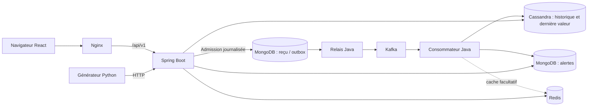

# Architecture de la plateforme

Le projet automatise le déploiement d’une plateforme de collecte de températures. L’application rend visible le rôle de chaque service imposé : ingestion continue, historique, dernière valeur et alertes. Le débit du générateur constitue une démonstration fonctionnelle ; il ne mesure pas une capacité Big Data.

## Répartition

| Élément | Responsabilité | Persistance |
| --- | --- | --- |
| React / Nginx | Interface, polling 2 secondes, proxy même origine `/api` | Fichiers statiques |
| Spring Boot Java 21 | Admission, outbox, consommation, API | Un seul backend, relais et consommateur concurrence 1 |
| MongoDB | Capteurs, reçus/outbox, alertes | Volume `mongo_data` |
| Kafka KRaft | Flux `mesures-temperature` et DLQ, 3 partitions, RF1 | Volume `kafka_data`, rétention 24 h |
| Cassandra | Historique partitionné par capteur/jour UTC et dernière mesure durable | Volume `cassandra_data` |
| Redis | Cache facultatif de dernière valeur, expiration 24 h | Reconstruit depuis Cassandra, mémoire 128 Mo |
| Générateur Python | Client HTTP séparé, valeurs normales ou élevées | Aucun accès direct aux bases |

## Parcours d’une mesure

1. L’API valide UUID, identifiant capteur, état actif, température finie entre −50 et 100 °C et date entre 2000 et maintenant + 5 minutes. Dates normalisées à la milliseconde.
2. Le seuil du capteur est figé dans l’événement. Un seul document MongoDB contient événement, empreinte et états indépendants de publication et de traitement. L’écriture utilise `w=majority&journal=true`. HTTP **202 signifie reçu durablement**, sans garantie de projection déjà visible.
3. Le relais publie les reçus en attente dans Kafka avec le capteur comme clé. Il attend la confirmation avant de marquer `PUBLISHED`. Une panne Kafka conserve le reçu et déclenche des reprises avec délai borné à 60 secondes. Le démarrage du consommateur est différé et retenté pour permettre à Java de démarrer même si le nom DNS du courtier arrêté est temporairement absent.
4. Le consommateur compare le message au snapshot du reçu, écrit l’historique Cassandra, met à jour conditionnellement la dernière mesure et crée une alerte si la température dépasse strictement le seuil figé. Redis est facultatif. Le reçu devient `PROCESSED` après les écritures durables ; l’offset est ensuite confirmé.
5. Trois nouvelles tentatives, espacées de deux secondes, précèdent la récupération DLQ. L’envoi en DLQ doit être confirmé. Une ingestion connue devient `FAILED`, sauf si déjà traitée. Le script de reprise ne réinitialise que les reçus en échec.
6. React interroge l’API toutes les deux secondes ; les bases restent inaccessibles au navigateur.

## Garanties et concurrence

Pas de transaction distribuée et pas d’exactly-once global. Une panne peut laisser des projections partielles ; le rejeu doit les compléter.

- Cassandra : clé stable `(capteur, jour, date, eventId)` ; l’upsert ne double pas la mesure.
- Dernière valeur : comparaison de `epochMillis` sur largeur fixe puis UUID ; CAS Cassandra et Lua Redis atomiques, y compris les dates identiques.
- MongoDB : `_id=eventId` pour les reçus et alertes. L’alerte utilise `setOnInsert`, donc un rejeu préserve son acquittement.
- Publication et traitement : mises à jour ciblées indépendantes ; le relais ne remplace jamais l’état du consommateur.
- Capteurs : version optimiste ; un PATCH obsolète produit 409.
- Curseurs : HMAC-SHA256 avec secret stable, lié au capteur, à la période et à la limite. Pas de snapshot en présence d’arrivées concurrentes.

## Deux machines virtuelles et poste Linux

| Hôte | Contenu | Ressources indicatives |
| --- | --- | --- |
| Poste Linux | Développement, VMware, contrôleur Ansible, runner CI/CD éventuel | 32 Go conseillés |
| VM data, exemple `192.168.56.11` | MongoDB, Cassandra, Kafka, Redis | 4 vCPU, 10 Go RAM, 60 Go disque |
| VM app, exemple `192.168.56.12` | Java, React/Nginx | 2 vCPU, 4 Go RAM, 30 Go disque |

Les VM Ubuntu et leurs accès SSH sont créés manuellement. Ansible prépare Docker, copie les configurations dans `/opt/plateforme`, démarre Compose et attend les probes. Deux fichiers Compose distincts sont nécessaires : Compose ne crée pas de réseau Docker multi-hôte ni les VM.

Le navigateur joint la VM app sur HTTP 80. Java joint les ports privés Mongo 27017, CQL 9042, Redis 6379 et Kafka 9092 de la VM data. Le contrôleur utilise SSH 22. Le listener Kafka et l’adresse RPC annoncée par Cassandra doivent être l’adresse privée accessible de la VM data. Le Compose data définit explicitement `CASSANDRA_BROADCAST_RPC_ADDRESS` pour éviter d’annoncer une adresse du bridge Docker à Java sur l’autre VM. Les pare-feu du laboratoire doivent limiter ces flux au réseau prévu : les ports publiés Docker demandent des règles réseau adaptées, et ne sont pas automatiquement protégés par une simple politique UFW.

## Objectif d’automatisation

L’infrastructure comme code apporte reproductibilité, versionnement et traçabilité. Les Dockerfile multiétapes produisent les images ; Compose décrit services, réseaux et volumes ; Ansible prépare et déploie ; la CI exécute la recette ; GHCR conserve les images identifiées par SHA de commit après validation. Le CD manuel réutilise Ansible sur un runner local connecté aux VM.

Un volume survit à un remplacement de conteneur, mais ne constitue pas une sauvegarde. La VM data unique reste un point de panne. Cette maquette n’est ni un cluster hautement disponible ni un service prêt à être exposé sur Internet.
