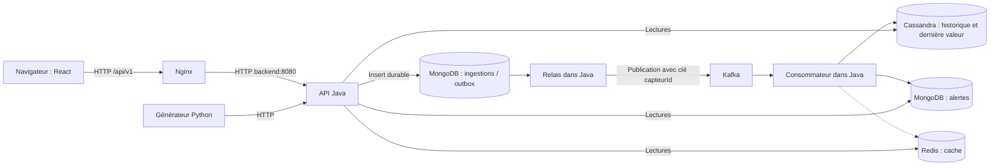
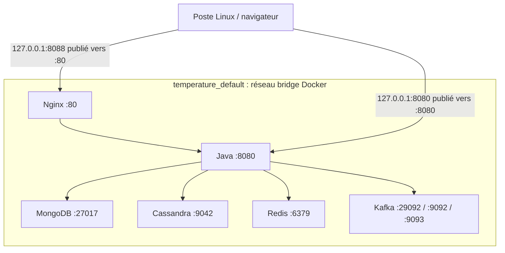
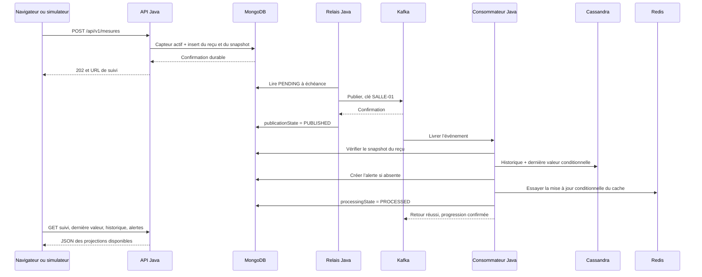
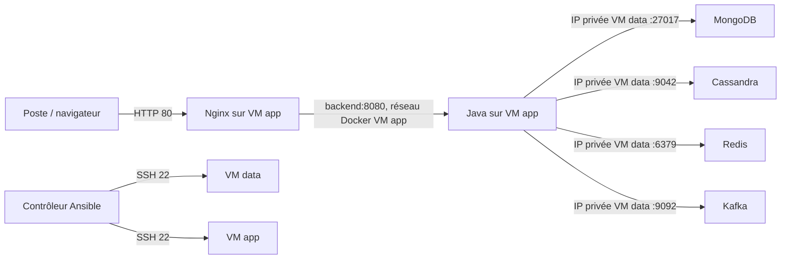

# Comprendre et reconstruire Thermo de A à Z

> Guide pédagogique du projet **Platforme-Big-Data-NoSql**. Lis-le avec le dépôt ouvert dans ton éditeur. L’objectif est de savoir quel fichier modifier, quelle commande exécuter, sur quelle machine, et quel résultat attendre.
>
> Les explications décrivent les fichiers livrés. Les commandes de déploiement sur deux VM constituent le parcours à exécuter lorsque tes VM et leurs accès SSH sont prêts. Le fonctionnement local, les tests et la publication des images ont été vérifiés pendant la réalisation ; le déploiement effectif sur tes deux VM reste une étape distincte.

## Sommaire

1. [Ce que nous construisons](#1-ce-que-nous-construisons)
2. [Les mots à comprendre avant les commandes](#2-les-mots-à-comprendre-avant-les-commandes)
3. [La carte des fichiers](#3-la-carte-des-fichiers)
4. [L’ordre de construction du projet](#4-lordre-de-construction-du-projet)
5. [Premier démarrage, commande par commande](#5-premier-démarrage-commande-par-commande)
6. [Comment les réseaux et les ports fonctionnent](#6-comment-les-réseaux-et-les-ports-fonctionnent)
7. [Comprendre un fichier Compose](#7-comprendre-un-fichier-compose)
8. [Comment chaque conteneur est créé](#8-comment-chaque-conteneur-est-créé)
9. [MongoDB : documents, capteurs, reçus et alertes](#9-mongodb--documents-capteurs-reçus-et-alertes)
10. [Kafka : événements, partitions et reprise](#10-kafka--événements-partitions-et-reprise)
11. [Cassandra : historique et dernière valeur durable](#11-cassandra--historique-et-dernière-valeur-durable)
12. [Redis : le cache facultatif](#12-redis--le-cache-facultatif)
13. [Le backend Java, fichier par fichier](#13-le-backend-java-fichier-par-fichier)
14. [Le trajet complet d’une mesure](#14-le-trajet-complet-dune-mesure)
15. [Le frontend et sa communication avec Java](#15-le-frontend-et-sa-communication-avec-java)
16. [Les deux Dockerfile, instruction par instruction](#16-les-deux-dockerfile-instruction-par-instruction)
17. [Ansible : comprendre tous les fichiers](#17-ansible--comprendre-tous-les-fichiers)
18. [Le déploiement sur deux VM](#18-le-déploiement-sur-deux-vm)
19. [GitHub, les tests et les images publiées](#19-github-les-tests-et-les-images-publiées)
20. [Vérifier, sauvegarder et diagnostiquer](#20-vérifier-sauvegarder-et-diagnostiquer)
21. [Refaire le projet toi-même et savoir quoi modifier](#21-refaire-le-projet-toi-même-et-savoir-quoi-modifier)
22. [Questions pour vérifier ta compréhension](#22-questions-pour-vérifier-ta-compréhension)
23. [Références et annexes des fichiers réels](#23-références-et-annexes-des-fichiers-réels)

---

## 1. Ce que nous construisons

Nous surveillons la température de salles. Chaque salle possède un capteur identifié, par exemple `SALLE-01`. Le capteur a un libellé, une salle, un seuil d’alerte et un état actif/inactif.

Un client envoie une mesure :

```json
{
  "eventId": "780c4ede-c522-4bc3-8d9c-9f100ed7a001",
  "capteurId": "SALLE-01",
  "date": "2026-11-03T12:00:00Z",
  "temperature": 45.2
}
```

- `eventId` identifie **cette mesure précise**. Il permet de reconnaître un renvoi du même événement.
- `capteurId` indique le capteur concerné.
- `date` indique quand la mesure a été prise. `Z` signifie UTC.
- `temperature` est la valeur mesurée, en degrés Celsius.

Si le seuil du capteur vaut 40 °C, 45,2 °C déclenche une alerte. Une valeur exactement égale à 40 °C ne la déclenche pas : la règle est « strictement supérieur ».

L’utilisateur peut consulter les dernières valeurs, une courbe historique, des statistiques et les alertes ; il peut aussi ajouter ou modifier un capteur et acquitter une alerte.

### 1.1 Pourquoi plusieurs technologies ?

Le sujet impose plusieurs services de données. Nous leur avons donné des responsabilités différentes :

| Élément | Ce qu’il fait dans ce projet | Exemple |
| --- | --- | --- |
| React | Affiche l’interface dans le navigateur | Tableau des capteurs et courbe |
| Nginx | Sert les fichiers de l’interface et transmet `/api` à Java | Reçoit la connexion HTTP sur 8088 en local |
| Spring Boot | Exécute les règles métier et l’API | Refuse un capteur inconnu, calcule le dépassement |
| MongoDB | Conserve les fiches, les reçus d’ingestion et les alertes | Document de `SALLE-01`, alerte acquittée |
| Kafka | Conserve un flux d’événements que Java consomme | Mesure en attente de traitement |
| Cassandra | Conserve l’historique et la dernière valeur durable | Mesures de `SALLE-01` pour une journée |
| Redis | Accélère la lecture de la dernière valeur | Hash `derniere:SALLE-01` |
| Python | Simule les capteurs en envoyant du HTTP | Une mesure par seconde, à tour de rôle |
| Docker Compose | Décrit et lance une pile de conteneurs sur une machine | Services, ports, volumes et dépendances |
| Ansible | Prépare les VM et y déploie Compose | Installation de Docker, copie des fichiers |
| GitHub Actions / GHCR | Teste le code, construit et conserve les images | Images associées à un commit |

Redis accélère une lecture ; Cassandra conserve la donnée durable qui permet de refaire cette lecture sans Redis. MongoDB conserve l’organisation métier et le reçu de l’événement. Kafka découple l’acceptation HTTP du traitement des projections.

### 1.2 La vue d’ensemble



L’API, le relais et le consommateur sont trois responsabilités **dans le même programme Java et le même conteneur backend**. Ils ne constituent pas trois microservices.

### 1.3 Big Data et NoSQL dans ce projet

**Big Data** renvoie notamment aux difficultés de volume, de vitesse d’arrivée et de variété des données. Ici, le générateur et Kafka illustrent une ingestion continue, tandis que plusieurs modèles de stockage servent des lectures différentes. Le débit de démonstration et les 10 001 lignes d’un test de limite vérifient des fonctions ; ils ne mesurent pas une capacité industrielle.

**NoSQL** regroupe plusieurs familles de stockages non relationnels : MongoDB organise des documents, Redis propose des structures associées à des clés et Cassandra organise ses tables selon des partitions. NoSQL ne signifie pas « sans schéma » : les validateurs Mongo et les tables CQL imposent bien une structure.

CQL ressemble à SQL dans sa syntaxe, mais le modèle de requête retenu pour Cassandra est centré sur les clés de partition. Kafka joue le rôle de plateforme de flux d’événements ; son usage ici est différent de celui d’une collection Mongo ou d’un cache Redis.

---

## 2. Les mots à comprendre avant les commandes

| Terme | Sens concret ici |
| --- | --- |
| Stack / pile | Ensemble de technologies ou de services constituant la solution ; une pile Compose regroupe ici les services d’un projet |
| Docker Engine | Moteur qui crée et exécute les conteneurs sur l’hôte ; la commande `docker` est son client |
| BuildKit / Buildx | Moteur de construction des images / outil CLI utilisé pour piloter des constructions avancées |
| SSH | Protocole de connexion distante sécurisé utilisé par Ansible pour administrer les VM |
| CLI | Interface de commande, utilisée dans un terminal |
| Code source | Les fichiers Java, JavaScript, CSS, YAML et scripts que tu modifies |
| Dépendance | Bibliothèque utilisée par le code, par exemple Spring Kafka ou React |
| Compilation / build | Transformation des sources en un résultat exécutable ou distribuable |
| Artefact | Résultat d’une construction : `app.jar`, dossier `dist/`, rapport de test |
| JDK | Outils Java permettant notamment de compiler avec `javac` |
| JRE | Environnement permettant d’exécuter une application Java déjà compilée |
| JAR | Archive Java ; notre `app.jar` contient l’application et ses dépendances exécutables |
| Image Docker | Ensemble de couches et métadonnées servant de modèle à des conteneurs |
| Conteneur | Processus lancé à partir d’une image, avec son environnement isolé |
| Registre d’images | Serveur qui conserve et distribue des images : Docker Hub, GHCR |
| Tag | Nom de version lisible, par exemple `8.0.32` ou un SHA de commit |
| Digest | Empreinte du contenu d’une image ou d’un manifeste, par exemple `sha256:...` |
| Couche | Résultat réutilisable d’une étape de construction d’image |
| Cache de build | Réutilisation de résultats précédents pour accélérer la construction |
| Volume nommé | Stockage géré par Docker, conservé indépendamment d’un conteneur |
| Bind mount | Montage d’un fichier ou dossier du poste dans un conteneur |
| Réseau bridge | Réseau local Docker reliant les conteneurs d’une machine |
| DNS | Résolution d’un nom, comme `mongodb`, vers une adresse IP |
| Port | Numéro d’entrée d’un service sur une adresse réseau |
| API | Interface permettant à un programme d’appeler un autre programme |
| HTTP | Protocole utilisé entre navigateur, Nginx, générateur et API |
| REST | Organisation de l’API autour de ressources et de méthodes HTTP |
| JSON | Format texte des requêtes, réponses et événements |
| YAML | Format indenté des fichiers Compose, Ansible et GitHub Actions |
| Client / pilote | Bibliothèque parlant le protocole d’un service de données |
| Collection / document | Regroupement MongoDB / enregistrement de type objet |
| Partition | Unité de répartition ; son sens précis dépend de Kafka ou Cassandra |
| Cache | Copie accélérant une lecture, reconstruisible depuis une source durable |
| TTL | Durée de vie avant expiration d’une donnée de cache |
| Outbox | Événement conservé durablement avant sa publication dans le flux |
| Projection | Vue dérivée d’un événement : historique, dernière valeur, alerte |
| Idempotence | Refaire une opération sans créer un effet métier supplémentaire indésirable |
| Cohérence éventuelle | Les différentes vues convergent après le traitement et les reprises |
| CI | Validation automatique du code et de son intégration |
| CD | Étapes automatisées de livraison ou de déploiement |
| Infrastructure comme code | Description versionnée de la préparation et du déploiement des machines |

### 2.1 Image, conteneur et VM : trois objets différents

Une VM fournit une machine avec son propre système et son noyau. Un conteneur utilise le noyau de sa machine hôte et isole principalement des processus, leur système de fichiers et leur environnement réseau.

Une image constitue le modèle du conteneur. Elle n’est pas, à elle seule, un service en cours d’exécution.

```text
Dockerfile + sources
        |
        | docker build
        v
      Image
        |
        | docker run, ou docker compose up
        v
    Conteneur actif
```

Dans ce projet, Docker ne crée pas les deux VM VMware. Les VM existent avant l’exécution du playbook Ansible.

### 2.2 Les quatre syntaxes de variables que tu vas rencontrer

| Syntaxe | Interprétée par | Exemple |
| --- | --- | --- |
| `${REDIS_PASSWORD}` | Compose lors de la lecture du YAML | Récupère la valeur fournie par `.env` |
| `$$REDIS_PASSWORD` dans Compose | Compose laisse passer un `$`, puis le shell du conteneur interprète la variable | Utilisé dans la commande Redis |
| `{{ ansible_host }}` | Ansible avec le moteur Jinja | Remplace une expression par l’adresse de la VM |
| `${{ github.sha }}` | GitHub Actions | SHA du commit exécuté dans le workflow |

Spring utilise aussi `${VARIABLE:valeurParDefaut}` dans `application.properties`, avec la syntaxe de repli propre à Spring. Il faut conserver la syntaxe attendue par chaque lecteur.

Le shell utilise aussi `$VARIABLE` ou `${VARIABLE}` dans les scripts. Pour comprendre une ligne, demande-toi toujours **quel programme lit le fichier en premier**.

---

## 3. La carte des fichiers

Les liens ci-dessous partent du dossier `docs/`, où se trouve ce guide.

| Fichier ou dossier | Rôle | Quand tu l’ouvres |
| --- | --- | --- |
| [`README.md`](../README.md) | Présentation du projet et démarrage rapide | Pour présenter ou lancer le projet |
| [`.env.example`](../.env.example) | Liste publique des variables privées à renseigner | Pour préparer la configuration |
| `.env` à la racine | Valeurs privées du poste ; ignorées par Git | Pour les accès techniques locaux |
| [`.gitignore`](../.gitignore) | Exclusions de Git | Pour éviter de publier secrets et fichiers générés |
| [`backend/pom.xml`](../backend/pom.xml) | Dépendances, version Java, construction Maven | Pour modifier le build Java |
| [`backend/mvnw`](../backend/mvnw) | Lanceur Maven Wrapper Linux | Pour construire sans Maven global |
| [`backend/.mvn/wrapper/maven-wrapper.properties`](../backend/.mvn/wrapper/maven-wrapper.properties) | Version de Maven téléchargée par le Wrapper | Pour figer l’outil de construction |
| [`backend/src/main/java/`](../backend/src/main/java/) | Contrôleurs, règles, stockages et pipeline | Pour le comportement du backend |
| [`backend/src/main/resources/application.properties`](../backend/src/main/resources/application.properties) | Connexions et paramètres Spring | Pour relier Java aux services |
| [`backend/src/test/java/`](../backend/src/test/java/) | Tests Java | Pour vérifier les décisions métier |
| [`backend/Dockerfile`](../backend/Dockerfile) | Construction de l’image Java | Pour comprendre comment le JAR devient un conteneur |
| [`frontend/package.json`](../frontend/package.json) | Bibliothèques et commandes du frontend | Pour installer, construire et tester React |
| [`frontend/package-lock.json`](../frontend/package-lock.json) | Versions exactes des dépendances JavaScript | Pour reproduire `npm ci` |
| [`frontend/index.html`](../frontend/index.html) | Page HTML d’entrée | Pour les métadonnées et le point de montage React |
| [`frontend/src/main.jsx`](../frontend/src/main.jsx) | Écran, états, formulaires, courbes et polling | Pour modifier les interactions |
| [`frontend/src/api.js`](../frontend/src/api.js) | Appels HTTP centralisés | Pour comprendre comment React appelle Java |
| [`frontend/src/style.css`](../frontend/src/style.css) | Apparence et adaptation mobile | Pour modifier le style |
| [`frontend/public/fonts/`](../frontend/public/fonts/) | Polices locales et licences | Pour servir l’interface sans Google Fonts à l’exécution |
| [`frontend/vite.config.js`](../frontend/vite.config.js) | Proxy de développement et construction | Pour le serveur local React |
| [`frontend/nginx.conf`](../frontend/nginx.conf) | Fichiers statiques et proxy API dans Docker | Pour l’entrée HTTP en conteneur |
| [`frontend/Dockerfile`](../frontend/Dockerfile) | Construction de l’image web | Pour passer des sources à Nginx |
| [`infra/compose.dev.yaml`](../infra/compose.dev.yaml) | Pile complète sur un seul hôte | Pour le laboratoire local |
| [`infra/compose.data.yaml`](../infra/compose.data.yaml) | Services de données sur VM data | Pour le déploiement deux VM |
| [`infra/compose.app.yaml`](../infra/compose.app.yaml) | Backend et web sur VM app | Pour le déploiement deux VM |
| [`infra/mongo/init.js`](../infra/mongo/init.js) | Compte applicatif, validateurs et index Mongo | Pour préparer MongoDB |
| [`infra/cassandra/001-schema.cql`](../infra/cassandra/001-schema.cql) | Keyspace et tables Cassandra | Pour comprendre le modèle historique |
| [`infra/cassandra/init-schema.sh`](../infra/cassandra/init-schema.sh) | Attente CQL, schémas et comptes | Pour l’initialisation authentifiée |
| [`infra/versions.env`](../infra/versions.env) | Références des images de données | Pour retrouver les versions retenues |
| [`ansible/`](../ansible/) | Inventaire exemple, configuration, collection et playbook | Pour préparer les VM et déployer |
| [`scripts/`](../scripts/) | Démarrage, tests, démonstration, reprise et sauvegarde | Pour automatiser les commandes répétées |
| [`postman/`](../postman/) | Collection de recette HTTP | Pour tester l’API avec Postman ou Newman |
| [`.github/workflows/`](../.github/workflows/) | CI, publication d’images et déploiement manuel | Pour comprendre GitHub Actions |
| [`docs/openapi.yaml`](openapi.yaml) | Contrat machine de l’API | Pour connaître les requêtes et réponses |
| [`docs/uml/`](uml/) | Diagrammes de conception fournis | Pour relier code et conception |

`backend/target/` et `frontend/dist/` sont générés. Les fichiers à modifier sont les sources ; le build recrée ces deux dossiers.

---

## 4. L’ordre de construction du projet

### 4.1 Ce qui a été fait dans le dépôt

Le dépôt existait déjà. Les contributions présentes sur GitHub ont été récupérées et intégrées. Le travail a ensuite suivi ces grands lots :

| Lot | Résultat construit | Branche de réalisation |
| --- | --- | --- |
| Socle | Java 21, Spring Boot, règles, routes, admission et pipeline | `feat/T001-T010-socle-contrat` |
| Services locaux | Compose, images, schémas, comptes et volumes | `feat/T011-T020-docker-services` |
| Recette | Générateur, contrôles HTTP, pannes, reprise et authentification | `feat/T021-T070-recette-pipeline` |
| Interface | Tableau de bord React et image Nginx | `feat/frontend-supervision` |
| Livraison | Documentation, Ansible, CI/CD, sauvegarde et corrections de reprise | `feat/T071-T100-livraison-documentation` |

Les PR 14 à 18 ont intégré ces lots sur `develop`. Les lots regroupent plusieurs fiches du guide de tâches. Le suivi détaillé est dans [suivi-taches.md](suivi-taches.md).

### 4.2 Si tu reconstruis le projet dans un dossier vide

L’ordre conseillé est le suivant :

1. Écrire les règles métier et les exemples de requêtes.
2. Choisir ce qui appartient à MongoDB, Cassandra, Redis et Kafka.
3. Définir les routes HTTP et les réponses attendues.
4. Initialiser Maven et le point d’entrée Spring Boot.
5. Créer Compose pour les services de données et écrire les schémas.
6. Relier Java aux services par des variables de configuration.
7. Développer les capteurs et l’admission durable MongoDB.
8. Ajouter le relais Kafka et le consommateur.
9. Écrire les projections Cassandra, MongoDB et Redis de façon idempotente.
10. Exposer les lectures et les statistiques.
11. Tester le trajet réel et les reprises.
12. Développer React sur le contrat HTTP stabilisé.
13. Construire les images Java et web.
14. Automatiser les validations et la publication.
15. Séparer les Compose des deux VM et écrire Ansible.
16. Documenter les résultats et les limites réellement vérifiés.

Ce chemin évite de dessiner une interface sans savoir d’où proviennent ses données, ou de multiplier les conteneurs avant de comprendre leurs responsabilités.

Pour recréer l’arborescence de départ :

```bash
mkdir -p backend/src/main/java/tg/iai/temperature
mkdir -p backend/src/main/resources backend/src/test/java/tg/iai/temperature
mkdir -p frontend/src infra/mongo infra/cassandra ansible scripts docs postman
mkdir -p .github/workflows
```

`mkdir -p` crée les dossiers manquants, y compris les parents. Ces commandes créent la structure ; les fichiers du dépôt apportent ensuite les implémentations expliquées dans ce guide.

---

## 5. Premier démarrage, commande par commande

### 5.1 Le poste et les outils

Pour l’exécution locale conteneurisée, il faut Git, Docker Engine, le plugin Compose v2, Bash, Python 3 et `curl`. Java 21 et Node 24 sont nécessaires sur le poste si tu veux développer en dehors des images de build.

Les constructions Docker téléchargent leurs propres outils Maven/Java et Node. Le poste n’a donc pas besoin d’un Maven global pour construire l’image Java.

Vérifier les outils sans modifier la machine :

```bash
git --version
docker version
docker compose version
python3 --version
curl --version
```

`docker version` distingue le client de commande et le serveur Docker. Une erreur d’accès au socket Docker concerne les droits du compte ou le service Docker ; elle ne signifie pas que le code Java est invalide.

Pour les scripts de restauration, utilise un Compose récent prenant en charge `!reset` et `!override` ; cette dernière syntaxe demande Compose 2.24.4 ou plus récent.

### 5.2 Récupérer la bonne branche

Depuis le dossier où tu ranges tes projets :

```bash
git clone https://github.com/HACKER2025998/Platforme-Big-Data-NoSql.git
cd Platforme-Big-Data-NoSql
git switch develop
```

- `git clone` copie l’historique et le contenu du dépôt.
- `cd` change le dossier courant du terminal.
- `git switch develop` place le dossier de travail sur la branche contenant l’application livrée.

Dans la suite, les commandes partent de cette racine, sauf quand un `cd` est explicitement indiqué.

### 5.3 Préparer les secrets

```bash
python3 scripts/init-env.py
```

Le script :

1. lit `.env` s’il existe ;
2. conserve les valeurs existantes ;
3. complète les mots de passe et le secret des curseurs qui manquent ;
4. utilise `secrets.token_hex(24)`, soit 24 octets aléatoires représentés par 48 caractères hexadécimaux ;
5. ajoute les noms de comptes par défaut ;
6. écrit `.env` avec permissions `0600`.

`0600` autorise le propriétaire à lire et écrire le fichier. `.gitignore` exclut ce fichier du dépôt. `.env.example` explique les variables sans fournir tes secrets.

Changer le mot de passe dans `.env` ne modifie pas, à lui seul, un compte déjà enregistré dans un volume de base de données. La rotation doit aussi changer ce compte dans le service concerné.

### 5.4 La commande principale

```bash
./scripts/dev-up.sh
```

Le préfixe `./` demande au shell d’exécuter le fichier présent dans le dossier courant.

Voici le travail du script, dans l’ordre :

```text
init-env.py
    → Compose up -d --build
    → migration MongoDB
    → interrogation répétée de readiness
    → affichage de l’URL de l’interface
```

`./scripts/compose.sh` est un raccourci qui fixe toujours les mêmes fichiers :

```bash
docker compose --env-file .env -f infra/compose.dev.yaml "$@"
```

- `--env-file .env` fournit les valeurs utilisées pour remplacer les variables du YAML.
- `-f` sélectionne le fichier Compose.
- `"$@"` transmet les arguments reçus par le script, sans casser les espaces et les guillemets.
- `up` crée ou met à jour les services décrits.
- `-d` laisse les conteneurs tourner en arrière-plan.
- `--build` demande la construction des services possédant une section `build`.

Les scripts commencent par `set -euo pipefail` : une commande en échec, une variable shell absente ou l’échec d’un élément d’un pipeline peut arrêter le script. Le but est de rendre les erreurs visibles.

### 5.5 Les objets créés

Avec le nom de projet par défaut `temperature`, tu retrouves normalement :

| Objet | Nom usuel | Rôle |
| --- | --- | --- |
| Réseau | `temperature_default` | Réseau bridge commun |
| Volume | `temperature_mongo_data` | Données MongoDB |
| Volume | `temperature_cassandra_data` | Données Cassandra |
| Volume | `temperature_kafka_data` | Journaux Kafka |
| Conteneur | `temperature-mongodb-1` | MongoDB |
| Conteneur | `temperature-cassandra-1` | Cassandra |
| Conteneur | `temperature-redis-1` | Redis |
| Conteneur | `temperature-kafka-1` | Courtier Kafka |
| Conteneur | `temperature-backend-1` | Java |
| Conteneur | `temperature-web-1` | Nginx |
| Tâche terminée | `temperature-cassandra-init-1` | Préparation des tables et comptes |
| Tâche terminée | `temperature-kafka-init-1` | Création des topics |

Le nom du projet peut être remplacé avec `-p`. Un numéro comme `-1` désigne une instance du service. Il n’est pas nécessaire de coder ces noms complets dans Java : Java utilise les noms de service, comme `mongodb`.

### 5.6 Observer le résultat

```bash
./scripts/compose.sh ps --all
./scripts/check-services.sh
curl -fsS 'http://localhost:8080/actuator/health/readiness'
```

- `ps --all` affiche aussi les tâches d’initialisation arrêtées.
- Un init en `Exited (0)` a terminé correctement.
- `check-services.sh` utilise les clients des services : Mongo, CQL, Redis et Kafka, puis la readiness Java.
- `curl -f` renvoie un échec pour une réponse HTTP d’erreur ; `-sS` réduit l’affichage tout en conservant les erreurs.

Ouvre ensuite **http://localhost:8088**.

### 5.7 Ajouter les données de démonstration

```bash
python3 scripts/demo.py
```

Ce script crée quatre salles si elles n’existent pas et envoie 200 mesures historiques par l’API. Il conserve la configuration des capteurs déjà présents. La visibilité des mesures suit le traitement asynchrone : attends sa progression avant de conclure que les données manquent.

Pour générer des mesures en continu :

```bash
python3 scripts/generate-measures.py --seed --count 10 --interval 1
```

`--count 10` désigne dix capteurs, parcourus à tour de rôle. `--interval 1` attend une seconde entre deux envois ; il ne signifie pas dix mesures par seconde.

Une démonstration bornée de valeur élevée :

```bash
python3 scripts/generate-measures.py --seed --count 1 --high --once
```

`--once` effectue un tour des capteurs choisis puis termine. `Ctrl+C` arrête le générateur continu.

### 5.8 Arrêter sans perdre les volumes

```bash
./scripts/dev-down.sh
```

Le script appelle Compose `down` : les conteneurs et le réseau du projet sont retirés, les volumes nommés sont conservés. Les mêmes volumes sont réutilisés au démarrage suivant.

`down -v` supprimerait aussi les volumes du projet. C’est une opération différente d’un arrêt courant.

---
## 6. Comment les réseaux et les ports fonctionnent

### 6.1 Le réseau local réellement utilisé

Dans `compose.dev.yaml`, il n’y a pas de section `networks:` personnalisée. Compose crée donc le réseau par défaut du projet, ici `temperature_default`, avec le pilote bridge.

Tous les services de cette pile y sont attachés. Docker fournit une résolution DNS interne : depuis Java, le nom `mongodb` permet de trouver le conteneur du service MongoDB.



Cette pile possède un réseau commun. Une segmentation en plusieurs réseaux applicatifs et de données n’est pas déclarée dans ces fichiers. Le mot « interne » du listener Kafka décrit ici son usage dans le réseau Docker ; aucun `internal: true` n’est déclaré pour le réseau Compose.

[Documentation officielle sur les réseaux Compose](https://docs.docker.com/compose/how-tos/networking/).

### 6.2 Lire une publication de port

```yaml
ports: ["127.0.0.1:8088:80"]
```

Lis cette ligne ainsi :

```text
adresse de l’hôte : port de l’hôte : port dans le conteneur
127.0.0.1        : 8088           : 80
```

Nginx écoute sur le port 80 **dans son conteneur**. Le navigateur du poste atteint ce port par `localhost:8088`.

Le préfixe `127.0.0.1` limite la publication à la boucle locale de l’hôte. Un collègue sur une autre machine ne peut pas utiliser ton propre `localhost` pour atteindre ce service.

### 6.3 Qui appelle quelle adresse ?

| Origine de l’appel | Destination | Adresse utilisée dans la pile locale |
| --- | --- | --- |
| Navigateur | Nginx | `http://localhost:8088` |
| Navigateur | API, par Nginx | URL relative `/api/v1/...` sur le même hôte |
| Nginx | Java | `http://backend:8080` |
| Java en conteneur | MongoDB | `mongodb:27017` dans l’URI Mongo |
| Java en conteneur | Cassandra | `cassandra:9042` |
| Java en conteneur | Redis | `redis:6379` |
| Java en conteneur | Kafka | `kafka:29092` |
| Générateur en conteneur | Java | `http://backend:8080` |
| Générateur sur le poste | Java | `http://localhost:8080` |
| Java lancé dans l’IDE | Services publiés par Docker | `localhost` avec leurs ports locaux |

Les communications Java → MongoDB, Redis, Cassandra et Kafka utilisent leurs protocoles et pilotes respectifs. Ce ne sont pas des requêtes REST envoyées à des URL `/api` des bases.

### 6.4 Pourquoi `localhost` peut être faux

`localhost` signifie « cette machine ou cet espace réseau » :

- dans le navigateur du poste : le poste ;
- dans le conteneur Java : le conteneur Java ;
- dans le conteneur Mongo : le conteneur Mongo ;
- sur VM app : VM app.

Ainsi, `localhost:27017` dans Java conteneurisé chercherait MongoDB dans le conteneur Java. Notre MongoDB est dans un autre conteneur ; Java doit employer `mongodb:27017`.

À l’inverse, un navigateur lancé sur le poste ne connaît généralement pas le nom Docker `backend`. Il utilise le port publié de Nginx.

### 6.5 Faut-il publier un port pour que deux conteneurs communiquent ?

Sur le réseau commun, Java peut joindre `redis:6379` sans publication du port Redis sur l’hôte. La section `ports` est utile pour les clients extérieurs à ce réseau Docker, notamment les outils du poste et Java lancé dans l’IDE.

`EXPOSE` dans un Dockerfile indique un port attendu. La publication effective se fait avec `ports` dans Compose ou `-p` avec `docker run`. L’application doit aussi réellement écouter sur ce port.

### 6.6 Ce qui se passe après un changement d’adresse IP

Un conteneur remplacé peut avoir une autre adresse IP. Son nom de service reste le point de référence.

Le proxy Nginx utilise :

```nginx
resolver 127.0.0.11 valid=5s ipv6=off;
location /api/ {
  set $backend backend:8080;
  proxy_pass http://$backend;
}
```

`127.0.0.11` est le résolveur DNS fourni par Docker dans ce type de réseau. L’utilisation d’une variable pour la destination permet à Nginx de résoudre ce nom pendant son fonctionnement, avec le résolveur déclaré. Il ne garde donc pas indéfiniment l’adresse obtenue à son démarrage.

Cette correction a été nécessaire lors des essais : après les arrêts/redémarrages de Java, un proxy gardant l’ancienne IP pouvait renvoyer 502 alors que l’API répondait sur son port direct.

### 6.7 Commandes pour observer le réseau

Ces commandes sont en lecture seule :

```bash
docker network ls
docker network inspect temperature_default
./scripts/compose.sh ps
./scripts/compose.sh port web 80
./scripts/compose.sh port backend 8080
```

- `network ls` liste les réseaux Docker.
- `network inspect` montre les conteneurs attachés et leurs adresses.
- `compose port` montre la publication d’un port interne.

Les adresses IP affichées sont utiles au diagnostic. Pour la configuration applicative, garde les noms de service.

---

## 7. Comprendre un fichier Compose

Compose lit du YAML. Les espaces définissent la structure. Dans ce dépôt, les services sont des enfants de `services:` ; les volumes nommés sont déclarés au niveau principal.

### 7.1 Les mots-clés utilisés

| Élément du YAML | Explication | Exemple du projet |
| --- | --- | --- |
| `name` | Nom par défaut du projet Compose | `temperature` |
| `services` | Dictionnaire des services à lancer | `backend`, `mongodb`, etc. |
| `image` | Image à récupérer ou utiliser | `mongo:8.0.32@sha256:...` |
| `build` | Dossier servant de contexte de construction | `../backend` |
| `restart: unless-stopped` | Redémarre un conteneur arrêté par son processus selon cette politique, sauf arrêt volontaire | Services permanents |
| `environment` | Variables injectées dans le processus du conteneur | `REDIS_HOST: redis` |
| `ports` | Publications des ports de l’hôte | `127.0.0.1:8080:8080` |
| `volumes` dans un service | Montages de stockage ou de fichiers | `mongo_data:/data/db` |
| `volumes` au niveau principal | Déclaration des volumes nommés | `mongo_data:` |
| `depends_on` | Conditions d’ordre de démarrage | Attendre `kafka-init` |
| `healthcheck` | Commande exécutée pour évaluer la santé du conteneur | `redis-cli ping` |
| `test` | Commande du healthcheck | Liste commençant par `CMD-SHELL` |
| `interval` | Fréquence du contrôle | `10s` |
| `timeout` | Durée maximale d’un contrôle | `5s` |
| `retries` | Échecs nécessaires pour déclarer l’état unhealthy | `30` |
| `entrypoint` | Remplace le programme d’entrée défini dans l’image | `bash /init-schema.sh` |
| `command` | Remplace la commande par défaut de l’image, généralement son `CMD` | Options de `redis-server` |
| `profiles` | Active certains services seulement sur demande | Générateur, profil `demo` |
| `stop_grace_period` | Temps laissé au processus avant l’arrêt forcé par Docker | `45s` pour Java |

`restart` ne fait pas automatiquement redémarrer un processus simplement parce que son healthcheck est `unhealthy`. Le healthcheck et la politique de redémarrage sont deux mécanismes distincts.

### 7.2 Les trois formes de remplacement des variables

```yaml
MONGO_APP_USERNAME: ${MONGO_APP_USERNAME:-temperature_app}
REDIS_PASSWORD: ${REDIS_PASSWORD:?Secret Redis requis}
CURSOR_SECRET: ${CURSOR_SECRET}
```

- `${VARIABLE:-valeur}` utilise une valeur de repli lorsque la variable est vide ou absente.
- `${VARIABLE:?message}` bloque la lecture du Compose lorsque la variable obligatoire manque ou est vide.
- `${VARIABLE}` demande un remplacement simple.

Lire `.env` pour interpoler le YAML ne signifie pas que toutes ses variables seront automatiquement disponibles dans tous les conteneurs. Ici, chaque service reçoit les variables indiquées dans sa section `environment`.

### 7.3 Pourquoi il y a `$$` dans certaines commandes

Exemple Redis :

```yaml
command: ["sh", "-c", 'exec redis-server --requirepass "$$REDIS_PASSWORD" ...']
```

1. Compose lit `$$` et laisse passer un `$` littéral.
2. Le conteneur reçoit une commande contenant `$REDIS_PASSWORD`.
3. `sh -c` interprète cette variable dans l’environnement du conteneur.

Un seul `$` risquerait de faire intervenir Compose à un autre moment que celui prévu. Les guillemets protègent également la valeur contre un découpage du shell.

### 7.4 Les dépendances ne disent pas toutes la même chose

```yaml
cassandra: {condition: service_started}
kafka: {condition: service_healthy}
kafka-init: {condition: service_completed_successfully}
```

- `service_started` : le processus est lancé ; sa préparation peut continuer.
- `service_healthy` : le healthcheck a réussi.
- `service_completed_successfully` : un traitement à exécution unique s’est terminé avec le code 0.

Dans notre pile, l’init Cassandra démarre après le démarrage du processus Cassandra. Il contient sa propre boucle d’attente. Il peut alors créer le compte applicatif nécessaire au healthcheck Cassandra. Attendre d’abord ce healthcheck créerait une dépendance circulaire.

Pour Kafka, le healthcheck peut réussir avant la création des topics métier. `kafka-init` attend donc Kafka healthy, puis Java attend la fin réussie de `kafka-init`.

### 7.5 Volumes et montages en lecture seule

```yaml
- mongo_data:/data/db
- ./mongo/init.js:/docker-entrypoint-initdb.d/001-init.js:ro
```

La première ligne est un volume nommé. MongoDB écrit ses fichiers de données dans `/data/db`, et Docker place ces données dans le volume.

La deuxième est un fichier du dépôt monté dans le conteneur. `:ro` signifie lecture seule du côté du conteneur.

Les chemins relatifs des montages et du contexte `build` sont interprétés à partir du fichier Compose principal. Avec `infra/compose.dev.yaml`, `./mongo/init.js` correspond donc à `infra/mongo/init.js` et `../backend` correspond au dossier `backend/` à la racine.

### 7.6 Valider un Compose sans démarrer la pile

```bash
./scripts/compose.sh config --quiet
```

Cette commande vérifie la configuration résolue sans l’imprimer. Une commande `config` sans `--quiet` peut afficher des variables privées remplacées dans les URI ; évite d’en publier la sortie.

---

## 8. Comment chaque conteneur est créé

### 8.1 Vue synthétique

| Service | Origine de l’image | Ce qui est lancé | Ce que nous avons écrit |
| --- | --- | --- | --- |
| `mongodb` | Image officielle MongoDB | Serveur Mongo | Init JS, variables, volumes et healthcheck |
| `cassandra` | Image officielle Cassandra | Serveur Cassandra | Configuration d’authentification et paramètres Compose |
| `cassandra-init` | Même image Cassandra | Shell + `cqlsh`, puis fin | Script et schéma CQL |
| `redis` | Image officielle Redis | `redis-server` avec options | Commande, authentification et limite mémoire |
| `kafka` | Image officielle Apache Kafka | Nœud KRaft broker/controller | Listeners et options Kafka |
| `kafka-init` | Même image Kafka | CLI de création des topics, puis fin | Boucle de création des topics |
| `backend` | Image construite depuis `backend/Dockerfile` | JVM exécutant `app.jar` | Code Java et Dockerfile |
| `web` | Image construite depuis `frontend/Dockerfile` | Nginx | React compilé, configuration Nginx et Dockerfile |
| `generator` | Image Python | Script monté `/generate.py` | Générateur HTTP |

Les images MongoDB, Redis, Cassandra et Kafka sont récupérées depuis leur registre. Nous n’avons pas réécrit leurs serveurs ni créé un Dockerfile pour chacune de ces bases.

### 8.2 Les fichiers de données survivent à quoi ?

Le processus peut s’arrêter, le conteneur être supprimé et une nouvelle instance être créée à partir de l’image. Les données présentes dans un volume nommé restent disponibles tant que ce volume est conservé.

Le stockage se répartit ainsi :

| Service | Dossier dans le conteneur | Stockage de la pile |
| --- | --- | --- |
| MongoDB | `/data/db` | `mongo_data` |
| Cassandra | `/var/lib/cassandra` | `cassandra_data` |
| Kafka | `/var/lib/kafka/data` | `kafka_data` |
| Redis | Cache utilisé en mémoire | Pas de volume Redis déclaré |
| Java | JAR dans `/app` | Code dans l’image, données dans les services |
| Nginx | Fichiers dans `/usr/share/nginx/html` | Fichiers statiques dans l’image |

Un volume sur une VM reste dépendant du disque de cette VM. La sauvegarde ajoute une copie récupérable ; elle répond à un autre besoin que le simple redémarrage d’un conteneur.

### 8.3 Le profil du générateur

Le générateur déclare `profiles: ["demo"]`. Pour le lancer dans Docker :

```bash
./scripts/compose.sh --profile demo up -d generator
./scripts/compose.sh logs -f generator
```

Il monte le script depuis le dépôt et appelle `http://backend:8080`. Son image finale est l’image Python officielle ; aucun build Python personnalisé n’est défini.

Pour l’arrêter sans arrêter les autres services :

```bash
./scripts/compose.sh stop generator
```

---

## 9. MongoDB : documents, capteurs, reçus et alertes

### 9.1 Comment penser MongoDB

Une base MongoDB contient des collections. Une collection contient des documents. Un document regroupe des champs et peut contenir des objets imbriqués.

MongoDB stocke des documents en BSON, un format binaire possédant davantage de types que le JSON. Les exemples JSON servent à les lire et les échanger facilement.

Dans notre base `temperature`, les collections métier sont :

```text
capteurs
    └── une fiche par identifiant de capteur

ingestions
    └── un reçu/outbox par eventId

alertes
    └── au maximum une alerte par eventId
```

### 9.2 La fiche d’un capteur

Exemple de forme persistée :

```json
{
  "_id": "SALLE-01",
  "libelle": "Capteur principal",
  "salle": "Salle serveurs",
  "seuilTemperature": 40,
  "actif": true,
  "version": 0,
  "createdAt": "2026-11-03T12:00:00Z",
  "updatedAt": "2026-11-03T12:00:00Z"
}
```

`_id` est l’identifiant unique MongoDB. L’API présente ce champ sous le nom `id` grâce à `Documents.view()`.

Le champ `version` empêche deux personnes de modifier silencieusement la même ancienne version. Le PATCH recherche l’identifiant **et** la version attendue, puis incrémente cette version. Si la condition ne correspond plus, Java renvoie 409.

Cette protection est écrite explicitement dans `SensorService`; elle ne repose pas ici sur une entité Java annotée `@Version`.

### 9.3 Le reçu et l’outbox sont le même document

Une admission crée notamment :

```json
{
  "_id": "780c4ede-c522-4bc3-8d9c-9f100ed7a001",
  "event": {
    "schemaVersion": 1,
    "eventId": "780c4ede-c522-4bc3-8d9c-9f100ed7a001",
    "capteurId": "SALLE-01",
    "date": "2026-11-03T12:00:00Z",
    "temperature": 45.2,
    "seuilApplique": 40,
    "acceptedAt": "2026-11-03T12:00:01Z"
  },
  "publicationState": "PENDING",
  "processingState": "PENDING",
  "tentatives": 0,
  "nextAttemptAt": 0
}
```

L’implémentation conserve aussi `empreinte`, une représentation canonique des données du client utilisée pour comparer les renvois. Le seuil est capturé au premier enregistrement. Il n’est pas relu lors d’un rejeu.

L’événement et ses états sont enregistrés par un insert dans un seul document. Cela évite d’avoir un reçu enregistré sans l’événement à publier dans un autre document.

### 9.4 Pourquoi MongoDB intervient avant Kafka

L’URI Java demande :

```text
w=majority&journal=true&serverSelectionTimeoutMS=3000
```

- `w=majority` définit le niveau de confirmation d’écriture demandé. Dans cette instance unique, il n’apporte pas de seconde copie sur une autre machine.
- `journal=true` demande la confirmation liée à la journalisation.
- `serverSelectionTimeoutMS=3000` borne l’attente de sélection d’un serveur disponible.

Après la confirmation de l’insert MongoDB, l’API renvoie HTTP 202. Cela signifie que le reçu est durablement admis. Kafka et les projections peuvent être encore en attente.

### 9.5 Le script `infra/mongo/init.js`

Son travail se décompose en quatre parties :

1. `db.getSiblingDB('temperature')` sélectionne la base applicative.
2. `getUser` puis `createUser` créent le compte applicatif s’il manque.
3. `createCollection` ou `collMod` installent les validateurs sur les collections.
4. `createIndex` prépare les index utilisés par les requêtes.

Les variables `MONGO_INITDB_ROOT_*` sont interprétées par l’image Mongo officielle pour son initialisation administrative. Les variables `MONGO_APP_*` sont lues par **notre script**, via `process.env`, pour créer le compte limité à la base applicative.

Le validateur vérifie notamment la présence des champs, certains types et les valeurs d’état permises. Les index aident à filtrer les salles, les alertes et les reçus en attente. L’unicité de chaque `_id` est déjà assurée par MongoDB.

Le montage dans `/docker-entrypoint-initdb.d/` fait exécuter ce script lors de l’initialisation d’un volume neuf. Pour appliquer le script sur un volume déjà existant :

```bash
./scripts/migrate-mongo.sh
```

Cette migration réexécute le script avec le compte administrateur ; elle conserve les documents existants.

### 9.6 Pourquoi le mot `upsert` est important pour une alerte

`upsert` signifie : mettre à jour si un document correspond, ou insérer s’il n’existe pas.

Le consommateur utilise `setOnInsert` pour les champs de l’alerte : ils sont renseignés uniquement lors de sa création. Si l’événement est relivré après acquittement, le document n’est pas remplacé et son état ACKNOWLEDGED reste conservé.

### 9.7 Entrer dans Mongo pour apprendre

```bash
./scripts/compose.sh exec mongodb sh
```

Tu es alors **dans le conteneur MongoDB**. Pour ouvrir le client sans écrire le mot de passe littéralement dans la commande :

```sh
mongosh --username "$MONGO_APP_USERNAME" \
  --password "$MONGO_APP_PASSWORD" \
  --authenticationDatabase temperature temperature
```

Dans `mongosh`, ces lectures permettent d’observer le projet :

```javascript
show collections
db.capteurs.find().limit(5)
db.ingestions.find({publicationState: "PENDING"}).limit(5)
db.alertes.find({statut: "OPEN"}).limit(5)
db.capteurs.getIndexes()
```

Pour le métier courant, utilise l’API. Le client de base sert ici à comprendre et diagnostiquer les données.

### 9.8 Le réglage de compatibilité du noyau

Le Compose contient `GLIBC_TUNABLES: glibc.pthread.rseq=1`. Il répond au problème MongoDB/TCMalloc rencontré avec le noyau du runner GitHub pendant la réalisation. Le réglage laisse glibc enregistrer rseq, ce qui évite le chemin de cache par CPU de TCMalloc concerné.

Le contexte, les références officielles et la raison de ce choix sont consignés dans [versions.md](versions.md). Il ne s’agit ni d’un identifiant de connexion ni d’un schéma de données.

---

## 10. Kafka : événements, partitions et reprise

### 10.1 Ce que Kafka conserve

Kafka conserve des événements dans un journal réparti en topics et partitions. Un événement de température est un fait à traiter : « le capteur X a mesuré Y à telle date ».

Notre événement comporte la donnée du client et le seuil figé par Java. Kafka ne décide pas lui-même qu’une température constitue une alerte : ce calcul est écrit dans le consommateur Java.

[Introduction officielle d’Apache Kafka](https://kafka.apache.org/40/getting-started/introduction/).

### 10.2 Les termes du flux

| Terme Kafka | Application au projet |
| --- | --- |
| Broker / courtier | Serveur Kafka qui reçoit et conserve les événements |
| Controller | Rôle coordonnant les métadonnées du cluster KRaft |
| KRaft | Mode de gestion des métadonnées utilisé ici, sans conteneur ZooKeeper |
| Topic | Flux nommé, par exemple `mesures-temperature` |
| Partition | Sous-journal ordonné d’un topic |
| Clé | `capteurId`, utilisée pour choisir une partition avec la stratégie du producteur |
| Valeur | JSON de l’événement |
| Offset | Position d’un enregistrement dans une partition |
| Producteur | Le relais Java qui publie |
| Consommateur | Le traitement Java qui lit les événements |
| Groupe | Identité collective des consommateurs : `traitement-temperature` |
| Commit d’offset | Confirmation de progression du groupe |
| Réplication | Nombre de copies d’une partition ; ici 1 |
| Rétention | Durée de conservation du journal ; ici 24 heures |
| DLQ | Topic séparé pour les enregistrements dont le traitement échoue durablement |

Le UUID `eventId` est un identifiant métier global de mesure. L’offset est une position Kafka propre à une partition. Ils répondent à deux besoins différents.

### 10.3 Trois partitions ne signifient pas trois serveurs

Le topic principal et la DLQ ont chacun trois partitions. Ces partitions sont hébergées par notre unique broker, avec facteur de réplication 1.

```text
mesures-temperature
  partition 0 : offset 0, 1, 2, ...
  partition 1 : offset 0, 1, 2, ...
  partition 2 : offset 0, 1, 2, ...
```

L’ordre garanti se raisonne dans une partition. La clé par capteur permet de conserver les événements d’un même capteur dans la même partition tant que ce partitionnement reste stable. Il n’y a pas d’ordre chronologique global entre tous les capteurs.

La concurrence du consommateur est 1 dans cette livraison. Le projet illustre le fonctionnement des partitions ; il ne démontre pas un cluster de plusieurs brokers tolérant aux pannes.

### 10.4 Tous les paramètres Kafka du Compose

| Variable | Explication |
| --- | --- |
| `KAFKA_NODE_ID: 1` | Identifiant du nœud Kafka |
| `KAFKA_PROCESS_ROLES: broker,controller` | Ce nœud combine les deux rôles pour le laboratoire |
| `KAFKA_LISTENERS` | Adresses et ports sur lesquels Kafka écoute |
| `KAFKA_ADVERTISED_LISTENERS` | Adresses que Kafka annonce aux clients après leur connexion initiale |
| `KAFKA_LISTENER_SECURITY_PROTOCOL_MAP` | Associe les noms INTERNAL, EXTERNAL, CONTROLLER au protocole PLAINTEXT |
| `KAFKA_INTER_BROKER_LISTENER_NAME: INTERNAL` | Listener prévu pour les échanges entre brokers |
| `KAFKA_CONTROLLER_LISTENER_NAMES: CONTROLLER` | Listener réservé au rôle controller |
| `KAFKA_CONTROLLER_QUORUM_VOTERS: 1@kafka:9093` | Liste des votants KRaft : un seul nœud ici |
| `KAFKA_OFFSETS_TOPIC_REPLICATION_FACTOR: 1` | Réplication adaptée au nœud unique pour les offsets internes |
| `KAFKA_TRANSACTION_STATE_LOG_REPLICATION_FACTOR: 1` | Réplication du journal interne d’état des transactions Kafka |
| `KAFKA_TRANSACTION_STATE_LOG_MIN_ISR: 1` | Nombre minimal de répliques synchronisées pour ce journal interne |
| `KAFKA_AUTO_CREATE_TOPICS_ENABLE: 'false'` | Les topics métier sont créés explicitement |
| `KAFKA_LOG_DIRS` | Dossier du journal persistant, monté sur le volume Kafka |
| `KAFKA_LOG_RETENTION_HOURS: 24` | Rétention du journal pour le laboratoire |

Les paramètres internes de transaction Kafka ne créent pas une transaction commune à MongoDB, Cassandra et Redis.

### 10.5 Les trois listeners

Dans la pile locale :

```text
INTERNAL   : kafka:29092      → clients du réseau Docker
EXTERNAL   : localhost:9092  → clients du poste
CONTROLLER : kafka:9093      → coordination KRaft
```

Il faut distinguer le port d’écoute de l’adresse annoncée. Un client peut atteindre le premier port, recevoir ensuite un nom inaccessible dans les métadonnées et échouer pendant la publication ou la consommation.

C’est pourquoi Java conteneurisé utilise `kafka:29092`, tandis que Java dans l’IDE utilise `localhost:9092`.

Dans le Compose data des deux VM, le listener EXTERNAL annonce `${DATA_BIND_IP}:9092` : c’est l’adresse privée de VM data accessible à Java sur VM app.

### 10.6 La création des topics

`kafka-init` utilise le client présent dans l’image officielle :

```bash
/opt/kafka/bin/kafka-topics.sh \
  --bootstrap-server kafka:29092 \
  --create --if-not-exists \
  --topic mesures-temperature \
  --partitions 3 \
  --replication-factor 1
```

- `--bootstrap-server` fournit une première adresse de connexion au cluster.
- `--create` demande la création du topic.
- `--if-not-exists` permet de rejouer l’initialisation sans recréer un topic existant.
- `--partitions 3` fixe le nombre initial de partitions.
- `--replication-factor 1` correspond au broker unique.

La boucle du Compose applique cette commande au topic principal puis à la DLQ, avant de terminer.

### 10.7 Le relais : publier ce qui a été reçu durablement

Dans `Pipeline.relay()` :

1. Toutes les deux secondes **après la fin de l’exécution précédente**, lire au maximum 50 reçus PENDING dont l’échéance est atteinte.
2. Prendre le snapshot `event` déjà enregistré.
3. Appeler `kafka.send(topic, capteurId, json)`.
4. Attendre la confirmation d’envoi, avec une attente bornée.
5. Mettre seulement `publicationState` à PUBLISHED et renseigner `publishedAt`.

En cas d’échec, le reçu garde son événement ; `tentatives` augmente et `nextAttemptAt` est repoussé de `min(60000, 2000 × tentatives)` millisecondes.

`fixedDelay=2000` ne promet donc pas un passage exactement toutes les deux secondes si l’envoi est lent. Le délai commence après la fin du travail précédent.

Le producteur utilise `acks=all`. Kafka attend les confirmations des répliques synchronisées concernées ; avec notre facteur de réplication 1, cela reste une seule copie de la partition. Cette confirmation ne signifie pas que Cassandra et MongoDB ont déjà reçu leurs projections.

### 10.8 Le consommateur : confirmer après les écritures

La configuration désactive `enable.auto.commit` et utilise `ack-mode=record`. Le framework confirme la progression après le retour réussi du traitement de l’enregistrement.

Le consommateur vérifie le message par rapport au reçu immuable MongoDB, effectue les écritures durables et marque PROCESSED. S’il lève une exception, le chemin de reprise entre en jeu.

La configuration `auto-offset-reset=earliest` s’applique lorsque le groupe ne possède pas de position de lecture exploitable : il part alors du début encore disponible du journal. Elle ne force pas à relire tout le topic à chaque redémarrage lorsqu’un offset valide a déjà été confirmé.

Les sérialiseurs String transforment clé et JSON texte en octets ; les désérialiseurs les reconstruisent à la lecture. Le client Kafka prend en charge le protocole réseau.

Confirmer un offset n’efface pas l’événement du journal Kafka. La suppression des segments dépend notamment de la rétention ; d’autres groupes peuvent avoir leur propre progression.

### 10.9 Réessais, DLQ et démarrage sans Kafka

`DefaultErrorHandler` utilise `FixedBackOff(2000, 3)` : trois nouvelles tentatives espacées de deux secondes après la tentative initiale.

Si l’échec persiste, le code publie le contenu brut dans `mesures-temperature-dlq` et attend la confirmation. Les en-têtes conservent topic, partition, offset d’origine et type d’erreur. Pour un reçu connu non déjà PROCESSED, le traitement est marqué FAILED.

Le démarrage automatique du listener est désactivé. Une tâche de Java essaie de le démarrer toutes les cinq secondes après vérification de la disponibilité requise. Cela permet à l’API de démarrer même lorsque le nom DNS du broker arrêté est momentanément absent. Le reçu MongoDB reste consultable et le relais peut reprendre après le retour de Kafka.

### 10.10 Observer Kafka

```bash
./scripts/compose.sh exec kafka \
  /opt/kafka/bin/kafka-topics.sh \
  --bootstrap-server kafka:29092 --list

./scripts/compose.sh exec kafka \
  /opt/kafka/bin/kafka-topics.sh \
  --bootstrap-server kafka:29092 --describe --topic mesures-temperature

./scripts/compose.sh exec kafka \
  /opt/kafka/bin/kafka-consumer-groups.sh \
  --bootstrap-server kafka:29092 \
  --describe --group traitement-temperature
```

Dans la sortie du groupe, le **lag** représente l’écart entre la progression du consommateur et la fin du journal pour les partitions concernées. Il s’exprime en positions ou enregistrements, pas directement en secondes de retard.

Pour lire quelques événements à titre d’observation :

```bash
./scripts/compose.sh exec kafka \
  /opt/kafka/bin/kafka-console-consumer.sh \
  --bootstrap-server kafka:29092 \
  --topic mesures-temperature --from-beginning \
  --max-messages 5 --timeout-ms 10000
```

Cette lecture est distincte du groupe métier. Elle ne doit pas utiliser `--group traitement-temperature` pour une simple observation, afin de ne pas participer au partage des partitions du consommateur de l’application.

---

## 11. Cassandra : historique et dernière valeur durable

### 11.1 Le modèle à comprendre

Cassandra est une base organisée par partitions. On conçoit les tables à partir des lectures à effectuer.

La lecture principale est : « donne les mesures de ce capteur, sur ces journées ». La table d’historique est donc partitionnée par capteur et jour UTC.

Un **keyspace** regroupe les tables et leur politique de réplication. Ici, le keyspace est `temperature`, avec réplication 1 dans `datacenter1`.

### 11.2 Lire la clé primaire

```sql
PRIMARY KEY ((capteur_id, jour), date_mesure, event_id)
```

- `(capteur_id, jour)` est la clé de partition.
- `date_mesure` et `event_id` sont les colonnes de classement à l’intérieur de la partition.
- Le classement est décroissant sur les deux colonnes.

Exemple :

```text
Partition : (SALLE-01, 2026-11-03)
  12:00:03 → event-c → 24.1
  12:00:02 → event-b → 23.8
  12:00:01 → event-a → 23.7
```

Le découpage par journée évite de ranger tout l’historique d’un capteur dans une partition qui grossirait sans fin. Il ne supprime pas automatiquement les anciennes journées : aucune purge historique automatique n’est définie ici.

### 11.3 Pourquoi une seconde table ?

`derniere_mesure` permet de lire directement la dernière valeur durable d’un capteur. Elle évite de parcourir des jours sans connaître à l’avance la date du dernier événement.

Elle contient `capteur_id`, `sort_key`, `date_mesure`, `event_id` et `temperature`.

`sort_key` est construite à partir de l’epoch en millisecondes sur 16 chiffres, suivi du UUID. Son ordre lexical fournit un classement déterministe, y compris si deux événements ont la même date.

### 11.4 L’écriture idempotente et le CAS

L’historique est écrit avec la même clé `(capteur, jour, date, eventId)` à chaque rejeu. Un nouvel envoi de la même mesure réécrit cette ligne au lieu d’ajouter une autre clé.

La dernière mesure utilise des conditions :

```sql
INSERT ... IF NOT EXISTS;
UPDATE ... IF sort_key < ?;
```

Ce mécanisme est un CAS, « comparer puis remplacer » : le remplacement est autorisé si la condition reste vraie. Une mesure plus ancienne rejoint l’historique sans faire reculer la dernière valeur.

### 11.5 Le schéma et les comptes

`001-schema.cql` crée le keyspace et les deux tables avec `IF NOT EXISTS`.

`init-schema.sh` :

1. vérifie le format des secrets avant leur interpolation dans les commandes CQL ;
2. attend que CQL accepte une connexion ;
3. essaie le mot de passe administrateur configuré, puis le mot de passe initial de Cassandra pour le premier démarrage ;
4. applique le schéma ;
5. crée le rôle `temperature_app` s’il manque ;
6. accorde SELECT et MODIFY sur le keyspace ;
7. remplace le mot de passe administrateur initial lors du premier passage.

Un rôle applicatif peut lire et modifier les données sans recevoir les droits de gestion des schémas. Le script ne constitue pas une procédure générale de rotation des mots de passe déjà existants.

La variable `CASSANDRA_APP_PASSWORD` ne crée pas magiquement ce rôle dans l’image officielle : c’est notre init qui l’utilise.

### 11.6 Les paramètres du conteneur Cassandra

| Paramètre | Utilité |
| --- | --- |
| `CASSANDRA_CLUSTER_NAME` | Nom logique du cluster |
| `CASSANDRA_DC` | Datacenter utilisé pour le keyspace et le pilote Java |
| `GossipingPropertyFileSnitch` | Mécanisme décrivant la topologie des nœuds |
| `MAX_HEAP_SIZE` | Réglage de tas Java fourni au démarrage de l’image Cassandra |
| `HEAP_NEWSIZE` | Autre réglage mémoire transmis à l’image ; son utilisation dépend de sa configuration JVM |
| `PasswordAuthenticator` | Active l’authentification des clients |
| `CassandraAuthorizer` | Active les autorisations selon les rôles |
| `CASSANDRA_BROADCAST_RPC_ADDRESS` dans le Compose data | Annonce l’adresse privée joignable depuis VM app |

Le `sed -i` du Compose remplace les lignes d’authentification de `cassandra.yaml` avant le démarrage normal de Cassandra. `exec` remplace le shell par le programme lancé et facilite la propagation des signaux d’arrêt.

### 11.7 Lecture de l’historique

`HistoryStore.read()` parcourt les journées demandées du plus récent au plus ancien. Chaque requête précise le capteur, la journée et les bornes temporelles. Aucun `ALLOW FILTERING` n’est utilisé dans ces lectures.

L’intervalle est `[du, au)` : la borne `du` est incluse et `au` est exclue. La période maximale est de sept jours. L’historique fournit un curseur signé ; les statistiques refusent un résultat dépassant 10 000 mesures au lieu de retourner une moyenne partielle.

### 11.8 Observer le schéma avec CQL

```bash
./scripts/compose.sh exec cassandra sh
```

Dans ce conteneur :

```sh
cqlsh -u temperature_app -p "$CASSANDRA_APP_PASSWORD"
```

Puis :

```sql
DESCRIBE KEYSPACE temperature;
SELECT * FROM temperature.derniere_mesure WHERE capteur_id = 'SALLE-01';
SELECT * FROM temperature.mesures_par_capteur_jour
WHERE capteur_id = 'SALLE-01' AND jour = '2026-11-03'
LIMIT 10;
```

Adapte la journée à tes données. Une requête valide sur une partition vide peut retourner zéro ligne sans que Cassandra soit en panne.

---

## 12. Redis : le cache facultatif

### 12.1 Ce que Redis conserve ici

Redis est un service de données en mémoire. Notre code utilise un hash par capteur :

```text
clé : derniere:SALLE-01
  sortKey → ordre de l’événement
  value   → JSON de la dernière mesure
```

Le mot « hash » désigne ici une structure Redis composée de champs et de valeurs. Il ne désigne pas la signature HMAC des curseurs.

Le hash expire après 86 400 secondes, soit 24 heures. L’historique Cassandra reste indépendant de cette expiration.

### 12.2 La comparaison atomique Lua

Le script de `LatestCache.put()` :

1. lit le champ `sortKey` actuel ;
2. compare cette clé à celle de l’événement reçu ;
3. écrit la nouvelle valeur seulement si elle est plus récente, ou si le cache est absent ;
4. définit le TTL.

Le script s’exécute atomiquement dans Redis : un autre client ne peut pas intercaler sa modification entre la comparaison et l’écriture. Deux commandes séparées côté Java ne fourniraient pas cette même protection.

### 12.3 La lecture avec repli

```text
GET dernière mesure
    → essayer Redis
    → si valeur exploitable : répondre
    → sinon lire Cassandra.derniere_mesure
    → essayer de réchauffer Redis
    → répondre avec la valeur durable
```

L’échec du cache est journalisé. Il n’empêche pas à lui seul le traitement durable d’une mesure ou une lecture quand Cassandra répond.

### 12.4 Le conteneur et ses options

```text
redis-server
  --requirepass ...
  --maxmemory 128mb
  --maxmemory-policy allkeys-lru
```

- `--requirepass` active le mot de passe utilisé par les clients.
- `--maxmemory` borne la mémoire configurée pour Redis.
- `allkeys-lru` autorise l’éviction de clés selon une stratégie approximant les clés les moins récemment utilisées.

La variable `REDIS_PASSWORD` est utilisée par notre commande de démarrage. Une simple variable d’environnement, sans cette commande ou une configuration équivalente, ne suffirait pas à protéger Redis.

Aucun volume Redis n’est déclaré : les dernières valeurs peuvent être reconstruites depuis Cassandra.

### 12.5 Observer le cache

```bash
./scripts/compose.sh exec redis sh
```

Dans le conteneur :

```sh
export REDISCLI_AUTH="$REDIS_PASSWORD"
redis-cli PING
redis-cli HGETALL derniere:SALLE-01
redis-cli TTL derniere:SALLE-01
```

`PING` vérifie une réponse du service, `HGETALL` affiche le hash et `TTL` son temps de vie restant. Évite de publier des données privées dans des captures de terminal.

---
## 13. Le backend Java, fichier par fichier

### 13.1 Ce qui tourne réellement

Le programme lancé est `BackendApplication`. Spring Boot démarre un serveur HTTP embarqué sur le port 8080, découvre les composants Java et prépare leurs dépendances.

Le client HTTP appelle un contrôleur. Le contrôleur délègue au service concerné. Celui-ci utilise les clients des stockages ou le pipeline selon son rôle.

Les appels MongoDB et CQL de ce code sont des appels synchrones de pilotes. Le caractère asynchrone du parcours vient de la séparation entre admission HTTP et traitement ultérieur par le flux.

### 13.2 Les annotations Spring que tu lis

| Annotation | Ce qu’elle signifie dans le code |
| --- | --- |
| `@SpringBootApplication` | Point de démarrage et configuration automatique de Spring Boot |
| `@EnableScheduling` | Active les méthodes planifiées, comme le relais |
| `@Component` | Demande à Spring de gérer une instance de cette classe |
| `@Service` | Composant portant une responsabilité de service métier |
| `@RestController` | Méthodes exposées comme API HTTP avec réponses sérialisées |
| `@RequestMapping` | Préfixe ou chemin associé à un contrôleur |
| `@GetMapping`, `@PostMapping`, `@PatchMapping` | Routes associées à une méthode HTTP |
| `@RequestBody` | Corps JSON converti en objet Java |
| `@PathVariable` | Partie variable d’un chemin, par exemple `{id}` |
| `@RequestParam` | Paramètre après `?`, par exemple `taille=20` |
| `@Value` | Lecture d’une propriété Spring |
| `@Bean` | Objet produit par une méthode et géré par Spring |
| `@Autowired` | Injection d’un composant géré par Spring |
| `@Scheduled` | Exécution planifiée d’une méthode |
| `@KafkaListener` | Méthode appelée pour des événements consommés depuis Kafka |
| `@RestControllerAdvice` / `@ExceptionHandler` | Transformation commune des exceptions en réponses HTTP |
| `@ConfigurationProperties` / `@Validated` | Regroupement et validation de propriétés de configuration |

L’**injection de dépendances** signifie par exemple que Spring fournit `Documents` au constructeur de `SensorService`. Le service n’a pas besoin de construire lui-même un nouveau client MongoDB à chaque requête.

### 13.3 La carte des classes

Les chemins de ce tableau sont relatifs à `backend/src/main/java/tg/iai/temperature/`.

| Classe | Principales responsabilités | Appelée par / dépend de |
| --- | --- | --- |
| `BackendApplication.java` | Démarrer Spring et activer les tâches planifiées | Commande `java -jar` |
| `ApiController.java` | Définir les routes, lire les paramètres, choisir statut et Location | Navigateur, générateur, Postman |
| `Rules.java` | Identifiants, UUID, températures, dates, périodes et tailles | Services et pipeline |
| `RequestFilter.java` | Limite des corps HTTP, identifiant de corrélation | Chaîne HTTP avant le contrôleur |
| `Errors.java` | Réponses ProblemDetail 400, 404, 409, 503… | Exceptions remontant dans l’API |
| `Documents.java` | Accès Mongo génériques, insert, lecture, pagination et présentation | Services, contrôleur et pipeline |
| `SensorService.java` | Création, lecture et PATCH versionné des capteurs | `ApiController`, admission |
| `IngestionService.java` | Validation, comparaison des doublons, seuil figé et insert durable | Route POST `/mesures` |
| `Pipeline.java` | Relais outbox, consommation, états, reprise, DLQ et démarrage différé | Scheduler et Spring Kafka |
| `HistoryStore.java` | CQL historique, CAS dernière valeur, pages et statistiques | Pipeline et routes de lecture |
| `LatestCache.java` | Cache Redis et repli Cassandra | Pipeline et route dernière mesure |
| `CursorCodec.java` | Encodage et vérification des curseurs HMAC | `HistoryStore` |
| `PlatformHealth.java` | Mongo, Cassandra et topics Kafka prêts | Readiness et démarrage du listener |
| `config/ClockConfig.java` | Horloge UTC à la milliseconde, propriétés typées | Services ayant besoin de l’heure |
| `config/PlatformProperties.java` | Définition validée des groupes de paramètres techniques | Configuration Spring |

L’implémentation utilise `MongoTemplate` et `org.bson.Document`, ainsi qu’une `CqlSession`. Elle n’utilise pas des entités JPA relationnelles ni un repository annoté pour chaque collection.

### 13.4 `ApiController` : la porte HTTP

Le préfixe est `/api/v1`. Le contrôleur reçoit notamment :

```java
@PostMapping("/mesures")
ResponseEntity<?> submit(@RequestBody Map<String, Object> m)
```

- `@PostMapping` associe la méthode à POST `/api/v1/mesures`.
- `@RequestBody` transforme le JSON en une map Java.
- Le contrôleur appelle `ingestion.submit(m)`.
- `ResponseEntity` permet de préciser HTTP 202, le corps et l’en-tête `Location`.

Le contrôleur des dernières valeurs vérifie d’abord le capteur. Si le capteur existe mais n’a aucune mesure, il renvoie 204. Un capteur absent produit 404.

### 13.5 `Rules` : les décisions communes

Les règles comprennent :

- identifiant de capteur entre 1 et 64 caractères, parmi majuscules ASCII, chiffres, tiret et underscore ;
- texte non vide, au maximum 120 caractères pour les champs concernés ;
- température et seuil dans la plage −50 à 100 ;
- UUID de mesure reconnu et normalisé ;
- date normalisée à la milliseconde, à partir de 2000 et au plus cinq minutes dans le futur ;
- période croissante de sept jours maximum ;
- listes limitées à 100, historique à 500 éléments par page ;
- rejet des propriétés inattendues pour les corps contrôlés.

Les mêmes fonctions sont utilisées à plusieurs endroits pour éviter des règles contradictoires.

### 13.6 `SensorService` et la concurrence

La création utilise un insert. Un identifiant déjà utilisé ne remplace pas silencieusement une fiche existante : il produit 409.

Pour un PATCH, le client envoie sa version connue :

```json
{
  "version": 0,
  "seuilTemperature": 35,
  "actif": true
}
```

Java fait une modification conditionnelle sur `_id` et `version`. Si elle réussit, la version devient 1. Un second PATCH encore basé sur la version 0 reçoit 409 et doit repartir d’une fiche récente.

### 13.7 `IngestionService` : recevoir sans perdre la demande

L’ordre est important :

1. Valider les champs du client.
2. Construire la représentation canonique à comparer.
3. Chercher un reçu existant avec le même UUID.
4. S’il existe, comparer les données et renvoyer le reçu identique, ou produire 409 si elles diffèrent.
5. Sinon, lire le capteur actif et son seuil.
6. Construire le snapshot d’événement.
7. Insérer le reçu PENDING/PENDING.
8. Renvoyer le résultat au contrôleur.

Le doublon est vérifié avant de relire la configuration actuelle du capteur. Ainsi, une mesure déjà admise reste rejouable même si le capteur a ensuite été désactivé ou son seuil modifié.

Deux demandes concurrentes peuvent tenter le même insert. La contrainte `_id` Mongo arbitre ; le code relit alors le reçu gagnant pour comparer son contenu.

### 13.8 `Documents` : ce que fait le client Mongo

Quelques méthodes à reconnaître :

```text
findById       → chercher par identifiant
insert         → créer, en refusant un doublon de clé
updateFirst    → modifier un document correspondant au filtre
findAndModify  → modifier conditionnellement et récupérer le résultat
upsert         → mettre à jour ou insérer
count          → compter les résultats du filtre
skip / limit   → choisir une page
```

`view()` renomme `_id` en `id`. Pour les reçus, il ajoute aussi `eventId` et `statusUrl` à la représentation de réponse. La présence de `id` et `eventId` dans cette réponse vient donc de cette méthode.

### 13.9 `CursorCodec` : un curseur opaque et signé

Le client ne choisit pas arbitrairement une position interne de Cassandra. Le backend encode un filtre et la dernière clé de la page, puis calcule une signature HMAC-SHA256 avec `CURSOR_SECRET`.

Au retour du curseur, le serveur :

1. borne sa taille ;
2. vérifie la signature ;
3. décode le contenu ;
4. vérifie qu’il correspond au même capteur, à la même période et à la même limite.

Base64 représente des octets en texte ; ce n’est pas un chiffrement. HMAC vérifie l’intégrité du curseur. Conserver le même secret au redémarrage permet de continuer à vérifier des curseurs émis précédemment.

La pagination ne fige pas tout l’historique : de nouveaux événements peuvent arriver entre deux pages. L’implémentation peut relire des lignes précédentes pour les ignorer selon la dernière clé ; elle privilégie ici la simplicité du laboratoire plutôt qu’une optimisation pour des partitions très volumineuses.

### 13.10 `RequestFilter`, erreurs et santé

Le filtre limite les corps POST/PATCH à 16 384 octets. Il conserve le corps lisible par le contrôleur après ce contrôle. Il valide ou crée un `X-Request-ID`, le renvoie et le place dans le contexte de journalisation.

`Errors` transforme les erreurs en ProblemDetail contenant notamment statut, détail et code. Une exception technique générique ne renvoie pas sa trace Java dans la réponse.

Les probes ont des fonctions différentes :

| Probe | Question posée | Dépendances externes |
| --- | --- | --- |
| Liveness | Le processus peut-il fonctionner ? | Ne dépend pas des bases |
| Readiness | L’application dispose-t-elle des dépendances requises pour ce parcours ? | Mongo, Cassandra et topics Kafka |

Redis est facultatif pour la disponibilité du parcours durable. Nginx bloque `/actuator`, tandis que le port direct local 8080 permet le diagnostic technique.

### 13.11 Lire `application.properties`

| Groupe de propriétés | Ce qu’il configure |
| --- | --- |
| `server.port` | Port HTTP Java, 8080 par défaut |
| `spring.mongodb.uri` | Connexion MongoDB dans cette version de Spring Boot |
| `spring.data.mongodb.auto-index-creation=false` | Les index sont préparés par les scripts d’infrastructure |
| `spring.cassandra.contact-points` | Adresse de départ CQL |
| `spring.cassandra.local-datacenter` | Nom de datacenter attendu par le pilote |
| `spring.cassandra.keyspace-name` | Keyspace de l’application |
| `spring.cassandra.schema-action=NONE` | Java ne crée ni ne supprime automatiquement les tables au démarrage |
| `spring.cassandra.username/password` | Compte applicatif Cassandra |
| `spring.data.redis.*` | Adresse, mot de passe et délais Redis |
| `spring.kafka.bootstrap-servers` | Première adresse Kafka |
| `spring.kafka.producer.*` | Sérialisation String, confirmations et délais d’envoi |
| `spring.kafka.consumer.*` | Désérialisation String, groupe, offsets et absence d’auto-commit |
| `spring.kafka.listener.ack-mode=record` | Progression après traitement d’un record |
| `spring.kafka.listener.concurrency=1` | Une instance de consommation dans ce lot |
| `spring.kafka.listener.auto-startup=false` | Démarrage contrôlé avec reprise dans `Pipeline` |
| `platform.topic` / `platform.dlq` | Noms des deux topics |
| `platform.cursor-secret` | Secret de signature des curseurs |
| `management.*` | Endpoints et groupes Actuator |
| `logging.*` | Format des journaux et niveau choisi |
| `server.shutdown=graceful` | Arrêt HTTP gracieux |
| `spring.lifecycle.timeout-per-shutdown-phase=30s` | Temps accordé par phase d’arrêt Spring |
| `spring.task.scheduling.shutdown.*` | Attente de terminaison des tâches planifiées à l’arrêt |

Une ligne comme :

```properties
spring.data.redis.host=${REDIS_HOST:localhost}
```

signifie : utiliser `REDIS_HOST` s’il est fourni ; sinon utiliser `localhost`. C’est ce mécanisme qui permet au même JAR de fonctionner sur le poste ou en conteneur.

Point de lecture important : le record `PlatformProperties` regroupe plusieurs paramètres et valide leur configuration, mais certaines limites du code livré restent écrites directement dans `Rules`, les annotations `@Scheduled` ou les méthodes. Modifier uniquement un champ de ce record ne modifie donc pas automatiquement toutes les décisions métier. Vérifie le site d’utilisation de la propriété dans le code.

### 13.12 Construire et lancer Java dans l’IDE

D’abord, démarrer les services de données :

```bash
python3 scripts/init-env.py
./scripts/compose.sh up -d mongodb cassandra cassandra-init redis kafka kafka-init
```

Attendre la santé des services et la fin réussie des init, puis :

```bash
./scripts/migrate-mongo.sh
cd backend
./mvnw -B verify
cd ..
python3 scripts/run-backend.py
```

`verify` exécute le cycle Maven jusqu’à la vérification, en passant par compilation, tests et packaging configuré. Le résultat exécutable est `backend/target/app.jar`.

Le lanceur Python lit `.env`, prépare notamment l’URI Mongo avec les identifiants encodés et lance Java. Il utilise `JAVA_HOME/bin/java` si `JAVA_HOME` est fourni, sinon la commande `java` du PATH. Configure ton environnement pour utiliser le JDK 21.

Pour exécuter ce backend local, le port 8080 doit être libre. Si le backend Docker y est déjà publié, arrête seulement ce service avant de lancer le JAR dans l’IDE.

---

## 14. Le trajet complet d’une mesure

Prenons `SALLE-01`, actif, seuil 40 °C, et une nouvelle mesure à 45,2 °C.



Le diagramme montre un ordre possible pour les deux états Mongo. Le consommateur peut terminer avant que le relais n’ait marqué PUBLISHED. Les mises à jour ciblées gardent ces deux états indépendants.

### 14.1 Les fichiers traversés

```text
frontend/src/main.jsx ou scripts/generate-measures.py
  → frontend/src/api.js, si appel depuis React
  → frontend/nginx.conf, si appel via le serveur web
  → RequestFilter
  → ApiController.submit
  → IngestionService.submit
  → Documents / MongoTemplate
  → Pipeline.relay
  → KafkaTemplate / broker Kafka
  → Pipeline.consume
  → HistoryStore.write
  → MongoTemplate.upsert pour l’alerte
  → LatestCache.put
  → mise à jour du reçu
```

Pour une lecture de dernière valeur :

```text
React → Nginx → ApiController → SensorService.get
    → LatestCache.get
    → Redis, ou HistoryStore.latest si nécessaire
    → réponse JSON
```

Pour une courbe :

```text
React → Nginx → ApiController.history
    → HistoryStore.history
    → CursorCodec si curseur fourni
    → lectures CQL par partitions
    → items + nextCursor
```

### 14.2 Ce que chaque panne produit

| Situation | Conséquence prévue |
| --- | --- |
| Mongo indisponible à l’admission | Pas de reçu durable, donc pas de faux 202 ; erreur technique 503 |
| Kafka indisponible après admission | Reçu conservé, publication PENDING et nouvelles tentatives |
| Java redémarre pendant cette attente | Relecture de l’outbox au retour ; listener démarré quand les dépendances sont prêtes |
| Cassandra échoue pendant le traitement | Pas de réussite complète ; reprises puis chemin DLQ si l’échec persiste |
| Redis échoue | Le traitement durable peut réussir ; la lecture utilise Cassandra |
| Événement livré deux fois | Même clé d’historique, dernière valeur monotone, alerte unique |
| Alerte acquittée puis événement rejoué | L’acquittement reste conservé |
| Nginx voit Java remplacé | Résolution DNS dynamique du nom `backend` |

Ce sont des mécanismes de reprise, pas une transaction distribuée. Une projection partielle peut exister temporairement. La rétention Kafka, la durée des pannes et les interventions d’exploitation restent des paramètres à maîtriser.

### 14.3 Faire un premier appel à la main

Créer un capteur, si cet identifiant n’est pas déjà présent :

```bash
curl -i -X POST 'http://localhost:8088/api/v1/capteurs' \
  -H 'Content-Type: application/json' \
  -d '{"id":"ATELIER-01","libelle":"Capteur atelier","salle":"Atelier","seuilTemperature":40,"actif":true}'
```

- `-i` affiche les en-têtes de réponse.
- `-X POST` choisit la méthode.
- `-H` ajoute l’en-tête du type de contenu.
- `-d` fournit le JSON.
- Le résultat attendu est 201 avec `Location`. Un identifiant déjà présent produit 409.

Pour générer une mesure avec un UUID et une date actuels sans inventer une date future :

```bash
python3 - <<'PY'
import datetime, json, urllib.request, uuid
body = {
    'eventId': str(uuid.uuid4()),
    'capteurId': 'ATELIER-01',
    'date': datetime.datetime.now(datetime.timezone.utc).isoformat(timespec='milliseconds'),
    'temperature': 45.2,
}
req = urllib.request.Request(
    'http://localhost:8088/api/v1/mesures',
    data=json.dumps(body).encode(),
    headers={'Content-Type': 'application/json'},
    method='POST',
)
with urllib.request.urlopen(req, timeout=15) as response:
    print('HTTP', response.status)
    print('Suivi :', response.headers.get('Location'))
    print(response.read().decode())
PY
```

Le reçu donne un UUID réel. Utilise ce UUID dans l’URL de suivi retournée :

```text
http://localhost:8088/api/v1/ingestions/UUID_DU_RECU
```

Puis lis :

```bash
curl -fsS 'http://localhost:8088/api/v1/capteurs/ATELIER-01/derniere-mesure'
curl -fsS 'http://localhost:8088/api/v1/alertes?capteurId=ATELIER-01&statut=OPEN'
```

Les URL sont placées entre guillemets : le shell ne doit pas interpréter `?` ou `&` comme ses propres caractères de commande.

---

## 15. Le frontend et sa communication avec Java

### 15.1 Où React s’exécute

Pendant la construction, Node et Vite transforment les sources React en fichiers HTML, JavaScript et CSS.

À l’exécution, Nginx envoie ces fichiers au navigateur. **Le JavaScript React s’exécute dans le navigateur de l’utilisateur.** Nginx reste le serveur des fichiers et le proxy HTTP. L’image web finale n’a pas besoin d’un serveur Node pour exécuter l’interface.

### 15.2 Le rôle des fichiers

| Fichier | Ce que tu y trouves |
| --- | --- |
| `index.html` | Élément `root`, métadonnées et chargement du point d’entrée |
| `src/main.jsx` | Fonction `App`, composants `Metric`, `Sensor`, `Empty`, navigation, formulaires, graphique |
| `src/api.js` | `request` et `send`, préfixe `/api/v1`, traitement des réponses et erreurs |
| `src/style.css` | Colonnes, cartes, tableaux, formulaire, navigation mobile et polices |
| `public/fonts` | Polices servies par Nginx et leurs licences |
| `vite.config.js` | Proxy de développement et découpage des bundles React/graphique |
| `package.json` | Dépendances et scripts `dev`, `build`, `preview`, `test:ui` |
| `package-lock.json` | Arbre exact des dépendances installé avec `npm ci` |
| `nginx.conf` | Comportement du serveur web dans l’image finale |

### 15.3 `useState`, `useEffect`, `useCallback`, `useRef`

| Outil React | Utilisation dans `App` |
| --- | --- |
| `useState` | Conserve un état affiché : capteurs, onglet, erreur, période, formulaire, reçu… |
| `useEffect` | Démarre un timer ou réagit à un changement ; nettoie aussi les timers et écouteurs |
| `useCallback` | Stabilise une fonction tant que ses dépendances n’ont pas changé |
| `useRef` | Garde une valeur entre rendus sans déclencher un nouvel affichage, notamment le drapeau de rafraîchissement |

Modifier un état avec sa fonction `set...` provoque un nouveau rendu. React met alors à jour ce qui doit être affiché.

### 15.4 Le polling réel du code

Le navigateur demande régulièrement des données : c’est du **polling**.

| Boucle | Fréquence configurée | Ce qu’elle fait |
| --- | --- | --- |
| `refresh` | 2 secondes | Liste des capteurs, alertes et dernières mesures de la page chargée |
| Historique / statistiques | 4 secondes hors onglet Historique | Rafraîchit les données de la courbe sélectionnée |
| Suivi d’un reçu | 2 secondes jusqu’à PROCESSED ou FAILED | Affiche le résultat de l’ingestion |

L’onglet Historique conserve les paramètres de période nécessaires à la pagination. Le code ne redemande pas continuellement une nouvelle période pendant que l’utilisateur parcourt ses pages.

`Promise.all` permet de lancer plusieurs demandes indépendantes ensemble. Le drapeau `refreshing` évite d’empiler des rafraîchissements complets encore en cours.

L’indicateur de moyenne du tableau de bord utilise les dernières valeurs chargées pour la page courante des capteurs. Les statistiques par période viennent, elles, de la route backend et de Cassandra.

### 15.5 L’appel HTTP centralisé

```javascript
fetch('/api/v1' + path, options)
```

Une URL relative conserve l’origine de la page : même protocole, même nom d’hôte et même port. Si la page vient de `http://localhost:8088`, la requête `/api/v1/capteurs` va d’abord à Nginx sur ce même port.

`api.js` :

1. ajoute le préfixe ;
2. fournit l’en-tête JSON ;
3. transforme HTTP 204 en `null` ;
4. lit le JSON ;
5. transforme une réponse d’erreur en message affichable ;
6. utilise un message d’indisponibilité si la réponse n’est pas du JSON attendu.

`send` prépare le corps avec `JSON.stringify` et choisit POST ou PATCH.

### 15.6 Les formulaires

Le formulaire produit un objet avec `FormData`. Le frontend convertit les champs numériques avec `Number(...)`. Pour une mesure, il crée un UUID avec `crypto.randomUUID()` et une date avec `new Date().toISOString()`.

La validation du navigateur améliore l’usage, mais Java applique aussi ses règles. Un client externe peut appeler l’API sans passer par ce formulaire.

Un PATCH de capteur transporte la version connue. Un acquittement appelle la route PATCH de l’alerte sans corps nécessaire. La création d’un capteur reçoit 201, l’admission d’une mesure reçoit 202 puis affiche le suivi.

### 15.7 Nginx, directive par directive

| Directive du fichier | Explication |
| --- | --- |
| `listen 80` | Port HTTP dans le conteneur web |
| `server_name _` | Nom générique pour cet hôte virtuel de laboratoire |
| `resolver 127.0.0.11 valid=5s ipv6=off` | Résolution DNS Docker avec durée configurée de cinq secondes, en IPv4 |
| `root /usr/share/nginx/html` | Dossier contenant le build React copié dans l’image |
| `client_max_body_size 16k` | Limite du corps HTTP au niveau du proxy |
| `X-Content-Type-Options: nosniff` | Indique au navigateur de respecter les types annoncés |
| `Referrer-Policy: same-origin` | Politique d’envoi de l’en-tête de provenance |
| `X-Frame-Options: DENY` | Refuse l’affichage de la page dans une frame |
| `location /` | Traitement des fichiers et chemins de l’interface |
| `try_files $uri $uri/ /index.html` | Sert le fichier demandé s’il existe, sinon l’entrée de l’application |
| `location /api/` | Branche les requêtes métier vers Java |
| `set $backend backend:8080` | Destination résolue dynamiquement |
| `proxy_pass http://$backend` | Transmet l’appel HTTP en conservant ici le chemin de requête |
| `proxy_connect_timeout 3s` | Délai de connexion vers Java |
| `proxy_read_timeout 15s` | Délai de lecture configuré côté proxy |
| `location /actuator { return 404; }` | Garde les probes hors du point d’entrée web |

### 15.8 Le développement avec Vite

```bash
cd frontend
npm ci
npm run dev
```

Le serveur de développement est accessible sur `http://localhost:5173`. Le proxy déclaré dans `vite.config.js` transmet `/api` à Java sur `http://localhost:8080`.

Dans ce mode, Vite joue le rôle de point d’entrée de développement. Dans l’image Docker finale, c’est Nginx qui sert le build et transmet les appels.

`npm ci` utilise le lockfile et convient à une installation reproductible. `npm install` est utilisé notamment lorsqu’on ajoute ou modifie des dépendances et que le lockfile doit évoluer.

Pour produire les fichiers statiques :

```bash
npm run build
```

Ils sont créés dans `frontend/dist/`. Vite regroupe le code en bundles ; la configuration sépare notamment React et les bibliothèques de graphique dans des chunks dédiés.

---

## 16. Les deux Dockerfile, instruction par instruction

Les Dockerfile complets sont reproduits en annexe et restent consultables directement dans le dépôt. Les digests y sont conservés : la partie après `@sha256:` fixe le contenu référencé, tandis que le tag reste lisible.

[Référence officielle des instructions Dockerfile](https://docs.docker.com/reference/dockerfile/).

### 16.1 Dockerfile du backend

| Instruction | Ce qui se passe et pourquoi |
| --- | --- |
| `FROM maven:3.9.11-eclipse-temurin-21@sha256:... AS build` | Commence une étape équipée de Maven et du JDK 21 ; son nom est `build` |
| `WORKDIR /src` | Définit le dossier courant de cette étape |
| `COPY pom.xml .` | Copie le fichier des dépendances et du build depuis le contexte |
| `COPY src src` | Copie les sources Java et ressources |
| `RUN --mount=type=cache,target=/root/.m2 mvn -B package` | Exécute Maven à la construction ; le cache Maven évite de retélécharger les dépendances déjà disponibles |
| `FROM eclipse-temurin:21-jre@sha256:...` | Commence une nouvelle étape finale contenant le runtime Java |
| `WORKDIR /app` | Dossier de l’application dans l’image finale |
| `RUN useradd --system --uid 10001 app` | Crée un utilisateur système pour exécuter Java sans utiliser root |
| `COPY --from=build /src/target/app.jar app.jar` | Récupère seulement le JAR de l’étape de construction |
| `USER 10001` | Choisit l’utilisateur d’exécution des instructions suivantes et du programme lancé |
| `ENV JAVA_TOOL_OPTIONS=...` | Définit des options JVM disponibles au démarrage |
| `EXPOSE 8080` | Documente le port attendu, sans le publier sur l’hôte |
| `ENTRYPOINT ["java","-jar","app.jar"]` | Commande réellement exécutée lors du démarrage du conteneur |

`mvn -B package` utilise le mode non interactif, compile, exécute les tests configurés dans ce cycle et produit le JAR. Le nom `app.jar` vient de `<finalName>app</finalName>` dans le POM.

Le cache `/root/.m2` appartient à l’étape de build, qui utilise son utilisateur par défaut. Le `USER 10001` concerne l’étape finale. Ces deux utilisateurs et environnements sont distincts.

`-XX:MaxRAMPercentage=70` règle la limite de tas JVM en pourcentage de la mémoire détectée. La valeur détectée dépend notamment des limites du conteneur ; ce paramètre ne réserve pas à lui seul de la RAM dans VMware ou Compose. `-Duser.timezone=UTC` définit le fuseau Java par défaut.

L’image finale contient le runtime et le JAR. Elle ne récupère pas automatiquement le compilateur, le dossier Maven, les sources et tout le cache de l’étape précédente.

### 16.2 Dockerfile du frontend

| Instruction | Ce qui se passe et pourquoi |
| --- | --- |
| `FROM node:24.11.0-alpine@sha256:... AS build` | Étape de construction équipée de Node et npm |
| `WORKDIR /app` | Dossier de travail de cette étape |
| `COPY package*.json ./` | Copie `package.json` et le lockfile avant les sources, pour permettre la réutilisation du cache d’installation |
| `ARG NPM_REGISTRY=https://registry.npmjs.org/` | Paramètre de construction ayant une valeur officielle par défaut |
| `RUN npm ci --registry="${NPM_REGISTRY}"` | Installe les dépendances définies dans le lockfile |
| `COPY . .` | Copie les sources du contexte frontend, selon les exclusions de `.dockerignore` |
| `RUN npm run build` | Produit les fichiers statiques dans `/app/dist` |
| `FROM nginx:1.28-alpine@sha256:...` | Commence l’image finale Nginx |
| `COPY nginx.conf /etc/nginx/conf.d/default.conf` | Remplace la configuration du site par celle du projet |
| `COPY --from=build /app/dist /usr/share/nginx/html` | Copie les fichiers construits à l’endroit servi par Nginx |
| `EXPOSE 80` | Indique le port du serveur web dans le conteneur |

Le Dockerfile frontend ne redéfinit pas `ENTRYPOINT` : il conserve le mécanisme de démarrage de l’image officielle Nginx. Il ne déclare pas non plus le même utilisateur `10001` que Java ; le fonctionnement du master et des workers suit cette image Nginx.

`ARG` configure le build. `ENV` définit une variable qui peut faire partie de l’environnement de l’image à l’exécution. Le paramètre de registre npm n’est pas une variable de connexion aux bases de l’application.

### 16.3 Les contextes et `.dockerignore`

Depuis la racine :

```bash
docker build -f backend/Dockerfile -t thermo-backend:apprentissage backend
docker build -f frontend/Dockerfile -t thermo-web:apprentissage frontend
```

Le dernier argument est le **contexte** de construction. Les chemins source des `COPY` sont relatifs à ce contexte.

Ainsi, pour Java, `COPY pom.xml .` lit `backend/pom.xml`. Il ne lit pas un éventuel `pom.xml` situé à la racine du dépôt.

Les `.dockerignore` excluent notamment `target`, `dist`, `node_modules` ou `.env` selon le contexte concerné. Ils réduisent les fichiers transmis et évitent de copier les résultats locaux inutiles.

Ces tags `thermo-...:apprentissage` servent à l’exercice manuel. Les noms locaux choisis automatiquement par Compose et les noms publiés dans GHCR ont leur propre convention.

### 16.4 Build et démarrage sont deux moments distincts

```text
RUN mvn package         → pendant la fabrication de l’image
ENTRYPOINT java -jar    → à chaque démarrage d’un conteneur Java
RUN npm run build       → pendant la fabrication de l’image web
Nginx                   → programme lancé dans le conteneur web final
```

Les bases de données n’ont pas besoin d’être joignables pendant la compilation du code. Les connexions configurées deviennent nécessaires au fonctionnement de l’application démarrée. Les tests unitaires du build et la recette avec services réels sont également deux catégories distinctes.

### 16.5 Le rôle de `pom.xml`

Le POM précise :

- le parent Spring Boot 4.0.9 et sa gestion des dépendances ;
- Java 21 ;
- les starters Web MVC, validation, Actuator, MongoDB, Cassandra, Redis, Kafka et tests ;
- Jackson 2 utilisé explicitement dans certaines manipulations JSON du code ;
- le nom du JAR et le plugin Spring Boot qui le rend exécutable avec ses dépendances.

`groupId`, `artifactId` et `version` identifient l’artefact Maven. La gestion des versions par le parent évite d’assembler arbitrairement des versions Spring incompatibles.

### 16.6 Les difficultés corrigées pendant la réalisation

| Observation réelle | Compréhension et solution appliquée |
| --- | --- |
| Dépendances npm inaccessibles directement dans l’environnement local de construction | Un relais réseau temporaire a été utilisé avec le paramètre `NPM_REGISTRY` ; le chemin standard du dépôt reste le registre officiel |
| MongoDB refusait le noyau du runner | Réglage de compatibilité documenté dans `versions.md` |
| Java ne redémarrait pas quand le nom DNS de Kafka arrêté disparaissait | Listener différé, vérification de disponibilité et nouvelles tentatives |
| Nginx appelait une ancienne IP de Java | Résolveur Docker et destination de proxy dynamique |
| Init Cassandra rejoué trop vite pouvait réécrire inutilement le mot de passe admin | Changement du mot de passe initial seulement lors du premier passage |

Le relais npm temporaire de la réalisation n’est pas un service de l’architecture. Ne configure pas arbitrairement le port local de ce relais sur ton poste : utilise la valeur officielle par défaut lorsque ton réseau y accède normalement.

---
## 17. Ansible : comprendre tous les fichiers

### 17.1 À quoi sert Ansible dans ce projet ?

Compose décrit les conteneurs d’une machine. Ansible se connecte à des machines distantes, prépare leur système, copie les fichiers appropriés et demande à Docker Compose d’y lancer les services.

```text
Poste Linux : contrôleur Ansible
    |
    | SSH
    +── VM data : installer Docker, copier Compose data, démarrer les bases
    |
    +── VM app  : installer Docker, copier Compose app, démarrer Java et Nginx
```

Ansible utilise principalement SSH et Python sur les VM Linux. Il n’est pas nécessaire d’installer un agent Ansible permanent dans chaque conteneur applicatif.

[Introduction officielle aux playbooks Ansible](https://docs.ansible.com/projects/ansible/latest/playbook_guide/playbooks_intro.html).

### 17.2 `ansible.cfg`

```ini
[defaults]
inventory = inventory.ini
host_key_checking = True
retry_files_enabled = False
interpreter_python = auto_silent
```

| Ligne | Sens |
| --- | --- |
| `[defaults]` | Groupe des options par défaut d’Ansible |
| `inventory = inventory.ini` | Fichier des machines utilisé par défaut dans ce contexte |
| `host_key_checking = True` | Vérifie les clés des serveurs SSH connus |
| `retry_files_enabled = False` | Ne produit pas les anciens fichiers de liste d’hôtes en échec `.retry` |
| `interpreter_python = auto_silent` | Laisse Ansible sélectionner l’interpréteur Python disponible sans l’avertissement de découverte habituel |

Les commandes de ce guide se placent dans le dossier `ansible/` pour utiliser ce `ansible.cfg`. Depuis un autre dossier, il faut tenir compte de la sélection de configuration Ansible et fournir explicitement l’inventaire si nécessaire.

La vérification des clés SSH demande que tu aies vérifié les empreintes réelles des VM et établi la relation de confiance correspondante. Elle ne se remplace pas par une désactivation systématique du contrôle.

### 17.3 `inventory.example.ini`

```ini
[data]
data01 ansible_host=192.168.56.11
[app]
app01 ansible_host=192.168.56.12
[all:vars]
ansible_user=deploy
```

- `[data]` crée le groupe des machines de données.
- `data01` est un alias Ansible, choisi par nous.
- `ansible_host` donne l’adresse réellement jointe par SSH.
- `[app]` désigne les machines applicatives.
- `[all:vars]` fournit des variables communes à tous les hôtes.
- `ansible_user=deploy` choisit le compte de connexion SSH.

Les IP sont des exemples du réseau privé du laboratoire. Le fichier réel se crée ainsi :

```bash
cp ansible/inventory.example.ini ansible/inventory.ini
```

Tu modifies ensuite `ansible/inventory.ini`. Il est ignoré par Git. Le playbook livré attend une VM data de référence et une VM app ; son expression `groups['data'][0]` prend explicitement le premier hôte du groupe data.

### 17.4 `requirements.yml`

```yaml
collections:
  - name: community.docker
    version: 4.8.1
```

Une **collection Ansible** contient des modules, plugins et ressources réutilisables. `community.docker` apporte notamment le module `docker_compose_v2` utilisé par notre playbook.

Ce fichier concerne les dépendances d’Ansible, pas les bibliothèques Maven ou npm et pas les images Docker.

Installation depuis le dossier Ansible :

```bash
cd ansible
ansible-galaxy collection install -r requirements.yml
```

`ansible-galaxy` installe la collection sur le poste qui exécute Ansible. Le module pilotera ensuite le plugin Docker Compose v2 présent sur les VM.

### 17.5 La structure de `deploy.yml`

Le playbook comporte trois **plays**, exécutés dans cet ordre :

1. préparer Docker sur `all` ;
2. déployer les services sur `data` ;
3. déployer l’application sur `app`.

Chaque play contient une liste de tâches. Chaque tâche appelle un module. Le module décrit un état ou une opération, par exemple « ce dossier doit exister » ou « ces paquets doivent être installés ».

Les tâches d’un play se lisent de haut en bas. Pour les modules qui le permettent, un nouvel appel vérifie l’état déjà présent et évite de refaire une modification inutile : c’est l’idempotence de la préparation.

### 17.6 Les mots-clés Ansible utilisés

| Mot-clé | Explication |
| --- | --- |
| `name` | Texte lisible dans l’affichage d’exécution |
| `hosts` | Groupe ou motif des machines concernées |
| `become: true` | Élévation de droits, généralement avec sudo, sur la machine distante |
| `tasks` | Liste ordonnée des tâches du play |
| `ansible.builtin.apt` | Gestion des paquets Debian/Ubuntu |
| `ansible.builtin.file` | Gestion d’un chemin, de son état et de ses permissions |
| `ansible.builtin.get_url` | Téléchargement d’un fichier vers la machine gérée |
| `ansible.builtin.apt_repository` | Déclaration d’une source de paquets apt |
| `ansible.builtin.service` | Gestion d’un service système |
| `ansible.builtin.copy` | Copie de fichiers du contrôleur vers la VM par défaut |
| `ansible.builtin.lineinfile` | Présence ou remplacement ciblé d’une ligne dans un fichier |
| `ansible.builtin.assert` | Arrêt explicite si des conditions obligatoires ne sont pas remplies |
| `ansible.builtin.uri` | Requête HTTP de validation |
| `community.docker.docker_compose_v2` | Pilotage d’un projet Docker Compose v2 sur l’hôte ciblé |
| `state: present` | Présence attendue, pour un paquet par exemple |
| `state: directory` | Le chemin doit être un dossier |
| `state: started` | Le service système doit être démarré |
| `enabled: true` | Le service doit démarrer avec le système |
| `loop` | Répétition de la tâche pour chaque élément |
| `item` | Élément courant d’une boucle |
| `register` | Nom de la variable qui reçoit le résultat de la tâche |
| `until` | Condition à atteindre par répétition |
| `retries` et `delay` | Nombre de reprises et espacement |
| `no_log: true` | Évite d’afficher le détail de cette tâche dans les journaux Ansible |
| `mode` | Permissions Unix du chemin ou fichier |

### 17.7 Premier play : préparer les deux VM

```yaml
hosts: all
become: true
```

Ansible se connecte avec le compte `deploy`, puis utilise l’élévation nécessaire aux opérations système. Ce compte SSH n’est pas le compte applicatif MongoDB ou Cassandra.

Par défaut, Ansible collecte des informations sur les machines, appelées **facts**. `ansible_distribution_release` provient de ces informations distantes, par exemple le nom de version Ubuntu de la VM.

Voici toutes les tâches de ce premier play :

| Tâche | Effet sur la VM | Pourquoi |
| --- | --- | --- |
| Installer certificats et curl | Installe `ca-certificates` et `curl`, actualise l’index apt | Préparer les téléchargements HTTPS |
| Créer `/etc/apt/keyrings` | Crée le dossier avec mode 0755 | Ranger la clé du dépôt Docker |
| Télécharger la clé Docker | Écrit `/etc/apt/keyrings/docker.asc`, mode 0644 | Permettre la vérification des paquets signés du dépôt |
| Ajouter le dépôt Docker Ubuntu | Crée une source apt nommée `docker` | Installer les paquets Docker du dépôt choisi |
| Installer Docker et Compose | Installe moteur, CLI, containerd, Buildx et Compose | Fournir les outils de conteneurisation |
| Activer Docker | Démarre le service et l’active au démarrage | Rendre le moteur disponible |
| Créer `/opt/plateforme` | Crée le répertoire avec mode 0750 | Ranger les fichiers déployés |
| Copier `.env` | Écrit `/opt/plateforme/.env`, mode 0600, sans détail de log | Fournir la configuration privée à Compose |

Le dépôt apt contient :

```text
deb [arch=amd64 signed-by=/etc/apt/keyrings/docker.asc]
https://download.docker.com/linux/ubuntu
{{ ansible_distribution_release }} stable
```

- `arch=amd64` cible l’architecture x86-64 de ce laboratoire.
- `signed-by` sélectionne la clé de vérification du dépôt.
- `ansible_distribution_release` adapte le nom de distribution au système détecté.
- `stable` désigne le canal choisi.

Le playbook ne fixe pas ici une version exacte des paquets Docker Engine apt. Les images applicatives et de données possèdent, elles, leurs propres références versionnées.

### 17.8 Comprendre les permissions

| Mode | Lecture simple |
| --- | --- |
| `0755` | Propriétaire : lire/écrire/traverser ; autres : lire/traverser |
| `0750` | Propriétaire : tous ces droits ; groupe : lire/traverser ; autres : aucun |
| `0644` | Propriétaire : lire/écrire ; autres : lire |
| `0600` | Propriétaire : lire/écrire ; groupe et autres : aucun |

Pour un dossier, le droit `x` autorise notamment sa traversée. Les valeurs sont écrites entre guillemets dans le YAML pour conserver clairement leur forme octale.

Le playbook travaille avec `become`, donc les fichiers privés déployés appartiennent normalement au contexte privilégié utilisé pour la copie. `no_log` protège l’affichage Ansible ; le fichier privé reste bien présent sur le disque de la VM.

### 17.9 Deuxième play : services de données

```yaml
hosts: data
become: true
```

**Copie des dossiers :**

```yaml
src: "../infra/{{ item }}"
dest: /opt/plateforme/
loop: [mongo, cassandra]
```

La tâche s’exécute une fois pour `mongo`, une fois pour `cassandra`. Les sources se trouvent sur le poste de contrôle, relativement au playbook. Le résultat attendu comprend :

```text
/opt/plateforme/
  .env
  compose.yaml
  mongo/init.js
  cassandra/001-schema.cql
  cassandra/init-schema.sh
```

Cette disposition correspond aux chemins relatifs déclarés dans le Compose data.

**Copie du Compose :** le fichier source `infra/compose.data.yaml` devient `/opt/plateforme/compose.yaml`. Le nom standard facilite la découverte par le module Compose.

**Ligne d’adresse :**

```yaml
regexp: '^DATA_BIND_IP='
line: 'DATA_BIND_IP={{ ansible_host }}'
```

`^` signifie « début de ligne » dans l’expression régulière. La tâche remplace une ligne existante de cette variable ou l’ajoute. L’adresse provient de l’inventaire de la VM data.

**Démarrage :**

```yaml
community.docker.docker_compose_v2:
  project_src: /opt/plateforme
  wait: true
  wait_timeout: 600
```

- `project_src` est le dossier du projet **sur la VM data**.
- Le module utilise le Compose et son `.env` dans ce dossier.
- `wait: true` attend l’état attendu des services, selon leur configuration de santé.
- `wait_timeout: 600` fixe une limite de dix minutes à l’attente des états des services ; les téléchargements d’images et autres préparations ont aussi leur propre durée.

### 17.10 Troisième play : application

```yaml
hosts: app
become: true
```

**Vérification des images :** le playbook exige `backend_image` et `web_image`. Il accepte une référence comportant un digest `@sha256:` ou un tag final formé de 40 caractères hexadécimaux.

Un tag dérivé du commit permet la traçabilité de la version de code ; un digest est directement lié au contenu de l’image. Un nom `latest` n’apporte pas cette même identification de livraison.

**Copie du Compose :** `infra/compose.app.yaml` devient `/opt/plateforme/compose.yaml` sur VM app.

**Écriture des variables :**

| Variable déployée | Expression source | Résultat attendu |
| --- | --- | --- |
| `DATA_HOST` | `hostvars[groups['data'][0]].ansible_host` | Adresse du premier hôte data de l’inventaire |
| `APP_BIND_IP` | `ansible_host` du play courant | Adresse privée de VM app |
| `BACKEND_IMAGE` | `backend_image` | Image Java choisie au lancement du playbook |
| `WEB_IMAGE` | `web_image` | Image web choisie au lancement du playbook |

`groups` permet de retrouver les hôtes des groupes. `hostvars` permet de lire les variables d’un autre hôte. La boucle `item.key` / `item.value` écrit chaque paire dans `.env`.

**Téléchargement et démarrage :** `pull: always` demande de vérifier les images auprès du registre avant le lancement. Les couches déjà présentes peuvent être réutilisées.

**Attente de Java :** la tâche `uri` vise `http://127.0.0.1:8080/actuator/health/readiness`. Elle est exécutée depuis VM app, où le backend publie ce port sur sa boucle locale.

`register: readiness` conserve le résultat. `until: readiness.status == 200` fait répéter jusqu’à l’état attendu, avec le nombre de reprises et l’espacement configurés. Le temps total inclut aussi les requêtes HTTP.

**Entrée utilisateur :** une dernière requête vérifie `http://{{ ansible_host }}/`, c’est-à-dire Nginx publié sur le port 80 de l’adresse privée de VM app.

### 17.11 Ce qu’Ansible ne fait pas à ta place dans ces fichiers

Le parcours attend des VM Ubuntu amd64 déjà créées, joignables en SSH, avec un compte disposant des droits sudo nécessaires. La préparation du réseau VMware et la vérification des accès SSH se font avant ce playbook.

Les fichiers livrés ne déclarent pas de création de VM, de certificat HTTPS, de cluster multi-nœud ou de règle complète de pare-feu du laboratoire. Le playbook actuel ne contient pas de découpage en rôles Ansible : ses tâches sont directement écrites dans trois plays.

---

## 18. Le déploiement sur deux VM

### 18.1 La répartition

| Machine | Fonction | Fichier utilisé |
| --- | --- | --- |
| Poste Linux | Git, développement, VMware, contrôleur Ansible ; runner local éventuel | Dépôt du projet |
| VM data, exemple 192.168.56.11 | Mongo, Cassandra, Redis, Kafka et init | `compose.data.yaml` |
| VM app, exemple 192.168.56.12 | Java et Nginx/React | `compose.app.yaml` |

Chaque VM possède son moteur Docker. Chaque Compose y crée son propre réseau :

```text
VM data : temperature-data_default
VM app  : temperature-app_default
```

Ces réseaux sont séparés. Le nom Docker `mongodb` de VM data n’est pas automatiquement un nom DNS utilisable depuis VM app.

### 18.2 Le chemin des échanges inter-VM



Sur VM data, les ports sont publiés sur `${DATA_BIND_IP}`. Sur VM app, Java reçoit `${DATA_HOST}` dans ses variables de connexion.

Kafka annonce l’adresse privée data dans son listener EXTERNAL. Cassandra annonce cette même adresse pour RPC/CQL via `CASSANDRA_BROADCAST_RPC_ADDRESS`. Les clients de l’autre VM ne doivent pas recevoir comme seule adresse exploitable une IP privée du bridge Docker de VM data.

### 18.3 Les différences entre les Compose

| Sujet | Local `compose.dev.yaml` | VM data | VM app |
| --- | --- | --- | --- |
| Sources applicatives | Construit backend et web | Aucune construction applicative | Télécharge les images GHCR choisies |
| Adresse des bases pour Java | Noms Docker locaux | Services hébergés ici | `DATA_HOST`, adresse privée de l’autre VM |
| Ports des bases | Publiés sur 127.0.0.1 du poste | Publiés sur l’adresse privée data | Aucun service de données local |
| Interface | `localhost:8088` | Aucune | Adresse privée app, port 80 |
| Port technique Java | `localhost:8080` | Aucun | 127.0.0.1:8080 sur VM app |
| Initialisations | Dans le même Compose que l’application | Exécutées avant le play applicatif | Dépendances data coordonnées par Ansible |
| Générateur | Profil `demo` disponible | Absent | Absent du Compose app livré |

Pour une démonstration distante avec le générateur du poste, il est possible de fournir `--url http://ADRESSE_VM_APP`. Son attente actuelle de readiness utilise aussi `/actuator`, que Nginx bloque : ce script n’est donc pas directement utilisable ainsi sans adapter ce contrôle ou utiliser un accès technique approprié. Le chemin livré et testé du générateur vise le backend direct local ou le backend du réseau Compose.

### 18.4 Préparer les VM

Dans VMware, créer les deux Ubuntu, prévoir leurs ressources et configurer un réseau privé partagé avec le poste. L’accès Internet sert notamment au téléchargement des paquets et images ; les adresses privées servent aux communications du laboratoire.

L’interface NAT VMware peut fournir l’accès Internet aux VM ; leur réseau privé partagé sert aux échanges entre le poste et les VM. La publication d’un port par Docker s’applique à l’hôte Docker concerné : elle ne crée pas à elle seule toutes les routes ou redirections dans VMware.

Les exemples de dimensionnement sont dans [architecture.md](architecture.md). Il faut aussi activer OpenSSH et créer le compte `deploy` avec les droits sudo prévus.

Depuis le poste, vérifier les connexions avec les vraies adresses :

```bash
ssh deploy@192.168.56.11
ssh deploy@192.168.56.12
```

Après vérification des empreintes, ces connexions établissent aussi les entrées connues utilisées par SSH. Si tu utilises une clé dédiée, indique-la avec `ssh -i` puis avec `--private-key` pour Ansible, ou configure ton agent SSH.

### 18.5 Les commandes Ansible

Depuis la racine du dépôt :

```bash
python3 scripts/init-env.py
cp ansible/inventory.example.ini ansible/inventory.ini
# Modifier les IP et le compte de connexion dans l’inventaire réel.
cd ansible
ansible-galaxy collection install -r requirements.yml
ansible all -m ping
ansible-playbook deploy.yml --syntax-check
```

`ansible all -m ping` vérifie la connexion Ansible et la disponibilité de son exécution Python. Ce module n’est pas le ping réseau ICMP classique.

Le contrôle de syntaxe valide la structure du playbook et la résolution des modules ; il ne démontre pas que les VM sont effectivement préparées.

Si les images GHCR sont privées, le compte Docker qui exécutera les téléchargements doit être authentifié. Comme le playbook utilise `become`, on peut préparer l’authentification privilégiée sur chaque VM :

```bash
sudo docker login ghcr.io
```

L’outil demande les informations adaptées au registre ; ne place pas un jeton dans le dépôt ou dans une commande publique.

Choisis ensuite un SHA réellement publié. Pour le récupérer depuis la référence distante connue, reviens à la racine :

```bash
cd ..
git fetch origin
release_sha="$(git rev-parse origin/develop)"
cd ansible
ansible-playbook deploy.yml \
  -e "backend_image=ghcr.io/hacker2025998/platforme-big-data-nosql-backend:$release_sha" \
  -e "web_image=ghcr.io/hacker2025998/platforme-big-data-nosql-frontend:$release_sha"
```

`$(...)` place le résultat de la commande dans la variable shell. Vérifie dans Actions que ce commit a effectivement fini ses tests et sa publication d’images. Un commit encore en validation peut être présent sur `develop` sans image disponible.

`-e` fournit des variables supplémentaires au playbook. Si sudo demande un mot de passe, l’option `--ask-become-pass` permet de le saisir interactivement selon la configuration de tes VM.

### 18.6 Où lire les fichiers après le déploiement

Sur chaque VM :

```bash
sudo ls -la /opt/plateforme
sudo docker compose --project-directory /opt/plateforme ps --all
```

Le `.env` distant reste privé. Les données persistantes sont dans les volumes Docker de VM data, pas dans ton dépôt Git du poste.

La disponibilité réseau doit être vérifiée depuis la machine qui émet réellement la connexion. Une base joignable depuis VM data n’est pas automatiquement joignable depuis Java sur VM app.

---

## 19. GitHub, les tests et les images publiées

### 19.1 Git, GitHub et GHCR

- Git conserve les versions des fichiers et leurs relations.
- GitHub héberge le dépôt, les branches, les PR et les exécutions Actions.
- GHCR conserve les images Docker construites et publiées.

Un `git push` envoie du code. Une publication Docker envoie des couches et des manifestes d’images. Ces deux opérations ont des protocoles, des outils et des espaces de stockage distincts.

### 19.2 Le parcours d’une modification

```bash
git switch develop
git pull --ff-only origin develop
git switch -c feat/ma-tache
# Modifier les fichiers concernés.
git diff
git add CHEMINS_DES_FICHIERS
git commit -m "Description de la modification"
git push -u origin feat/ma-tache
```

Puis créer une pull request vers `develop`. Une PR montre les différences et les résultats de validation avant la fusion.

`--ff-only` demande une mise à jour sans créer automatiquement une fusion divergente. `-u` mémorise la relation de suivi de la branche distante.

Le SHA d’un commit est une empreinte Git identifiant cet état et son historique. Le SHA du commit de fusion peut être différent de celui du dernier commit de la branche de fonctionnalité.

### 19.3 `ci.yml` : les événements et les jobs

Le workflow `Validation` se lance sur PR vers `develop` ou `main`, ainsi que sur push sur ces branches.

| Élément | Rôle |
| --- | --- |
| `on` | Événements qui déclenchent le workflow |
| `permissions: contents: read` | Droits nécessaires pour lire le dépôt par défaut dans ce workflow |
| `concurrency` | Regroupe les exécutions d’une même référence et peut annuler une exécution dépassée |
| `jobs` | Ensembles de travaux exécutés sur des runners |
| `runs-on: ubuntu-24.04` | Type de machine du runner GitHub hébergé |
| `steps` | Étapes ordonnées d’un job |
| `uses` | Appel d’une action ou d’un workflow réutilisable |
| `run` | Commandes exécutées dans le shell du runner |
| `working-directory` | Dossier où l’étape exécute ses commandes |
| `needs` | Dépendance entre jobs |
| `if` | Condition d’exécution |
| `timeout-minutes` | Durée maximale du job |

Le job `unit-build` récupère le dépôt, installe les versions Java/Node choisies, exécute Maven, construit React, valide OpenAPI puis conserve les rapports Java.

Le fichier `openapi.yaml` du dépôt est écrit sous forme JSON, également acceptée comme YAML. Il décrit le contrat de l’API ; il ne génère pas automatiquement nos contrôleurs et ne signifie pas qu’une page Swagger UI a été installée.

### 19.4 Le job d’intégration

Le runner crée sa propre pile Docker, indépendante de tes volumes de développement, puis exécute :

1. la recette HTTP sur les vrais services ;
2. les pannes et le redémarrage de Java avec outbox en attente ;
3. le contrôle réel du budget statistique avec 10 001 lignes ;
4. Postman via Newman ;
5. la recette navigateur Playwright.

Les rapports sont conservés comme **artifacts GitHub Actions**. Ici, « artifact » peut donc désigner un rapport de test, tandis qu’une image est publiée dans GHCR.

`if: always()` permet notamment de récupérer les résultats et d’arrêter la pile même après un échec. Il ne transforme pas l’échec des tests en succès.

### 19.5 Les tests du dépôt et leurs commandes

| Commande | Ce qu’elle vérifie |
| --- | --- |
| `cd backend && ./mvnw verify` | Tests Java et build configuré |
| `cd frontend && npm ci && npm run build` | Dépendances et construction React |
| `python3 scripts/recette.py` | Contrat HTTP et parcours réel des données |
| `python3 scripts/recette-pannes.py --test-stack temperature` | Pannes Redis/Kafka/Mongo, redémarrage Java, rejeu et DLQ |
| `python3 scripts/recette-volume.py --test-stack temperature` | Dépassement 10 000, réponse 422 et page historique limitée |
| `./scripts/run-postman.sh` | Collection Postman avec Newman épinglé |
| `cd frontend && npx playwright install chromium && npm run test:ui` | Parcours navigateur sur la pile Docker déjà prête |

Un test unitaire ou isolé vérifie une petite responsabilité, parfois en remplaçant ses dépendances par des doubles de test. Un test d’intégration vérifie des composants assemblés ; notre recette emploie les vrais services. Un test de bout en bout vérifie aussi le chemin utilisateur dans le navigateur.

Les scripts de panne et de volume sont réservés à une pile de laboratoire de test. Ils arrêtent temporairement des services ou créent des données dédiées ; ce ne sont pas de simples commandes de consultation.

Les tests d’intégration du projet utilisent HTTP et Compose. Ils ne sont pas des classes Testcontainers Java portant les noms proposés dans les fiches du backlog. Les adaptations et les scénarios restant hors de la recette sont documentés dans [resultats-recette.md](resultats-recette.md) et [suivi-taches.md](suivi-taches.md).

### 19.6 La publication GHCR

Le job `publish` dépend de `unit-build` et `integration`. Sa condition exige un push sur `develop`. Une PR peut donc être validée sans publication d’image de livraison.

Le fichier `images.yml` est un workflow réutilisable, appelé par `ci.yml` avec `workflow_call`. Il :

1. récupère le code de `github.sha` ;
2. prépare Buildx ;
3. se connecte à GHCR avec le jeton fourni au workflow ;
4. normalise le nom de dépôt en minuscules ;
5. construit une matrice backend/frontend ;
6. publie chaque image avec le SHA du commit comme tag.

Les noms produits sont :

```text
ghcr.io/hacker2025998/platforme-big-data-nosql-backend:SHA_DU_COMMIT
ghcr.io/hacker2025998/platforme-big-data-nosql-frontend:SHA_DU_COMMIT
```

Les images de données officielles restent fournies par leurs registres d’origine. Ce workflow publie les deux images applicatives du projet.

### 19.7 Pourquoi il existe plusieurs caches différents

| Cache | Emplacement / usage |
| --- | --- |
| Maven du poste | Bibliothèques utilisées par le Wrapper du poste |
| Cache `/root/.m2` du build Docker | Téléchargements Maven dans le build Java |
| Couches Docker | Résultats de certaines instructions d’image |
| Cache npm | Téléchargements de paquets JavaScript |
| Cache GitHub Actions / Buildx | Réutilisation entre exécutions distantes selon les options configurées |
| Redis | Données applicatives de dernière mesure, à l’exécution |

Le cache Maven du poste n’est pas automatiquement le même dossier que celui du build Docker. Redis ne participe pas à la compilation des images.

### 19.8 `deploy.yml` du workflow GitHub

Il faut distinguer :

- `ansible/deploy.yml` : les tâches de préparation et de déploiement des VM ;
- `.github/workflows/deploy.yml` : la façon de demander à un runner d’exécuter ce playbook.

Le workflow de déploiement contient :

| Élément | Sens |
| --- | --- |
| `workflow_dispatch` | Déclenchement manuel, avec un paramètre `commit` |
| Entrée `commit` | SHA de 40 caractères correspondant aux images choisies |
| `runs-on: [self-hosted, linux, temperature-lab]` | Exige un runner installé dans l’environnement du laboratoire avec ces labels |
| `environment: laboratoire` | Environnement GitHub associé au job |
| `actions/checkout` avec `ref` | Récupère le code de cette version |
| Fichiers dans `/opt/temperature-secrets` | Inventaire et `.env` privés préalablement installés sur le runner |
| Copie temporaire dans le checkout | Donne les entrées attendues au playbook |
| `ansible-playbook ... -e ...` | Déploie les deux images portant le SHA demandé |
| Nettoyage avec `if: always()` | Retire les copies privées du checkout après l’exécution |

La disponibilité d’un workflow manuel dans GitHub dépend aussi de sa présence et de la configuration de la branche par défaut du dépôt. Le playbook reste exécutable directement depuis le poste sans passer par ce bouton.

Un runner GitHub hébergé ordinaire n’a pas automatiquement accès au réseau privé VMware de ton poste. C’est la raison du runner `self-hosted` pour ce déploiement.

### 19.9 Revenir à une version précédente

Choisis le SHA d’une version déjà validée et publiée, puis relance le playbook avec ces deux références d’images. Les volumes sont conservés.

Un retour d’image ne revient pas automatiquement en arrière sur les données ou les schémas. Il faut vérifier leur compatibilité avant un retour à une ancienne version du programme.

---
## 20. Vérifier, sauvegarder et diagnostiquer

### 20.1 La boîte à outils quotidienne

| Besoin | Commande depuis la racine |
| --- | --- |
| Voir les services, y compris les init terminés | `./scripts/compose.sh ps --all` |
| Suivre Java | `./scripts/compose.sh logs -f backend` |
| Voir les dernières lignes d’un service | `./scripts/compose.sh logs --tail 100 mongodb` |
| Lire les init | `./scripts/compose.sh logs cassandra-init kafka-init` |
| Voir les ressources consommées | `docker stats` |
| Voir les images présentes | `docker image ls` |
| Voir les volumes | `docker volume ls` |
| Voir le réseau du projet | `docker network inspect temperature_default` |
| Diagnostiquer les protocoles et Java | `./scripts/check-services.sh` |
| Vérifier le Compose | `./scripts/compose.sh config --quiet` |
| Recréer après modification du code ou du Dockerfile | `./scripts/compose.sh up -d --build backend web` |
| Arrêter la pile sans supprimer les volumes | `./scripts/dev-down.sh` |

`docker stats` continue à rafraîchir son affichage ; `Ctrl+C` quitte cet affichage sans arrêter les conteneurs.

`docker compose restart backend` redémarre le conteneur existant. Un changement du Dockerfile ou de sources à compiler demande une construction et une recréation adaptées, comme `up -d --build`. Un simple restart ne recompile pas le JAR.

Il faut aussi distinguer trois emplois du mot « journal » : le journal d’événements Kafka, la journalisation durable interne de MongoDB et les journaux de diagnostic visibles par `docker compose logs`. Effacer des logs applicatifs n’équivaut pas à consommer un événement Kafka.

### 20.2 Lire un état unhealthy

Exemple de lecture ciblée :

```bash
docker inspect temperature-mongodb-1 --format '{{.State.Health.Status}}'
```

Les doubles accolades de cette commande sont un template de l’outil Docker, pas une expression Ansible. Le même caractère peut appartenir à plusieurs syntaxes ; le programme qui lit la commande détermine son sens.

Puis lire les journaux du service et la commande du healthcheck dans le Compose. Un port TCP ouvert ne prouve pas que l’authentification, les schémas et les topics sont utilisables.

### 20.3 Raisonner avec les codes HTTP

| Code | Signification dans le projet | Où chercher |
| --- | --- | --- |
| 200 | Lecture ou modification réussie | Corps JSON renvoyé |
| 201 | Capteur créé | `Location` et fiche |
| 202 | Reçu durable admis | Route de suivi d’ingestion |
| 204 | Capteur connu sans dernière mesure | Envoyer une première mesure |
| 400 | Paramètre, format ou règle d’entrée invalide | Message ProblemDetail et contrat |
| 404 | Ressource absente | Identifiant, route, ou Actuator volontairement masqué via Nginx |
| 409 | Doublon contradictoire, version obsolète ou capteur inactif selon la route | Reçu existant ou fiche récente |
| 413 | Corps trop volumineux | Taille JSON, Nginx et `RequestFilter` |
| 422 | Budget de statistiques dépassé | Réduire la période |
| 502 | Le proxy ne joint pas correctement Java | Backend, réseau, résolution DNS Nginx |
| 503 | Dépendance requise indisponible ou readiness dégradée | Java et services de données |

### 20.4 Une mesure ne s’affiche pas : l’ordre du diagnostic

1. Vérifie que le POST a reçu 202 et relève `eventId` / `statusUrl`.
2. Lis le reçu. PENDING de publication signifie que le relais doit encore publier ou reprendre.
3. Vérifie Kafka et les logs `outbox_unavailable`, `PUBLICATION_UNAVAILABLE` ou `consumer_start_pending`.
4. Si le traitement reste PENDING, contrôle le consommateur et les dépendances durables.
5. Si le traitement est FAILED, inspecte la DLQ et la cause technique.
6. Si le reçu est PROCESSED, vérifie les routes de lecture et la période choisie dans la courbe.
7. Compare l’accès direct Java avec l’accès via Nginx pour distinguer API et proxy.

Une mesure historique peut être correctement enregistrée sans apparaître sur une courbe réglée sur « dernière heure ». Une ancienne mesure peut aussi être présente dans l’historique sans devenir la dernière valeur.

### 20.5 Rejouer une ingestion en échec

Après correction de la cause :

```bash
./scripts/replay-ingestion.sh UUID_DU_RECU_EN_ECHEC
```

Le script vérifie le format de l’identifiant puis effectue une mise à jour conditionnelle dans Mongo : il ne remet en attente que le reçu correspondant à l’état FAILED. Il restaure les états PENDING et permet au relais de republier le snapshot original.

Ce script n’est pas une route REST publique. Il s’agit d’une commande d’exploitation locale utilisant le client Mongo du conteneur.

### 20.6 Sauvegarder la petite pile du laboratoire

Avant une sauvegarde de démonstration, arrête les générateurs et laisse le jeu prévu finir son traitement. Puis :

```bash
./scripts/backup-dev.sh /tmp/temperature-sauvegarde-atelier
```

Le dossier cible doit être vide. Le script :

1. crée un répertoire privé ;
2. arrête le backend pour stabiliser les écritures effectuées par l’application ;
3. exporte la base Mongo applicative avec `mongodump --archive --gzip` ;
4. exporte les deux tables Cassandra avec `COPY ... TO` en CSV ;
5. copie le schéma, les versions et le commit source ;
6. redémarre le backend grâce à un `trap` de sortie.

`trap` demande au shell d’exécuter une action lorsqu’il sort du script, y compris après de nombreux types d’erreurs.

La sauvegarde ne copie pas `.env`. Elle constitue un export logique Mongo/Cassandra du laboratoire. Les journaux Kafka et leurs offsets ne sont pas exportés par ce script ; des événements encore en attente dans le flux demanderaient une stratégie de sauvegarde et de reprise plus complète. Redis est reconstruisible.

Un chemin sous `/tmp` convient à l’exercice. Pour conserver une sauvegarde, choisis un stockage privé durable adapté à ton poste ; un fichier temporaire peut être supprimé par le système.

### 20.7 Restaurer sans toucher aux volumes de travail

```bash
./scripts/restore-dev.sh \
  /tmp/temperature-sauvegarde-atelier \
  temperature-restore-atelier
```

Le nom doit commencer par `temperature-restore-` et ne doit pas déjà posséder des volumes Docker. Le script refuse ainsi d’écraser une pile existante.

Il crée une configuration supplémentaire temporaire :

- retire les publications des ports des bases pour éviter les conflits ;
- utilise les images applicatives locales déjà construites ;
- publie Java sur 8092 et Nginx sur 8098 ;
- conserve un nom de projet distinct, donc des réseaux et volumes distincts.

Les syntaxes `!reset` et `!override` sont des mécanismes de fusion de configuration Compose. Ici, elles retirent ou remplacent certaines valeurs du Compose principal.

Le script démarre les services et leurs init, importe Mongo puis les CSV Cassandra, démarre l’application sans refaire ces dépendances déjà préparées et attend readiness.

Adresses de la copie restaurée :

```text
API directe : http://localhost:8092
Interface   : http://localhost:8098
```

La recette locale a retrouvé quatre fiches, quatre dernières valeurs et 200 mesures historiques d’un jeu connu. Ce résultat vérifie la récupération locale de ce jeu ; il ne remplace pas une politique industrielle de sauvegarde, de rétention et de restauration hors VM.

### 20.8 Les limites à garder dans le raisonnement

- Un seul hôte data peut interrompre tous les stockages s’il tombe.
- Trois partitions Kafka avec réplication 1 ne fournissent pas de redondance entre machines.
- Aucune transaction unique n’englobe tous les services.
- La rétention Kafka est de 24 heures dans le laboratoire ; le registre Mongo et l’historique Cassandra n’ont pas de purge automatique dans cette livraison.
- La rotation des journaux Docker dépend de la configuration du moteur ; une politique `logging` spécifique n’est pas déclarée dans ces Compose.
- L’API ne possède pas de comptes utilisateurs ni JWT ; son usage livré est local ou dans le réseau privé isolé.
- Les communications inter-VM ne sont pas chiffrées par TLS dans cette maquette.
- Les performances sous forte charge et la haute disponibilité constituent des travaux différents de cette recette fonctionnelle.

---

## 21. Refaire le projet toi-même et savoir quoi modifier

### 21.1 Parcours de reconstruction en douze ateliers

Chaque atelier apporte une preuve observable avant le suivant.

| Atelier | Ce que tu écris ou relis | Preuve à obtenir |
| --- | --- | --- |
| 1. Besoin et contrat | Règles, exemples JSON, routes OpenAPI | Expliquer 201, 202, 204, 409 et les champs d’une mesure |
| 2. Socle Java | POM, Wrapper, `BackendApplication`, horloge | Compiler avec Java 21 |
| 3. Services Docker | Compose des quatre services de données | Clients Mongo, CQL, Redis et Kafka répondent |
| 4. Schémas et accès | Mongo init, Cassandra CQL et rôles | Comptes applicatifs opérationnels, init rejouables |
| 5. Capteurs | `Rules`, `Documents`, `SensorService`, routes | Créer, lire, modifier avec version et désactiver |
| 6. Admission | `IngestionService` et reçu Mongo | 202 durable, renvoi identique accepté, contradictoire refusé |
| 7. Kafka | Topics, configuration, relais | Un reçu passe de PENDING à PUBLISHED |
| 8. Projections | Consommateur, Cassandra, alerte et Redis | PROCESSED, historique, dernière valeur et alerte attendue |
| 9. Lectures | Curseur, période, statistiques, acquittement | Pagination cohérente et acquittement conservé au rejeu |
| 10. Interface | React, API client et CSS | Les données réelles apparaissent et les formulaires fonctionnent |
| 11. Images et CI | Dockerfile, Nginx, workflows et tests | Images reconstruites et recette indépendante réussie |
| 12. Deux VM et exploitation | Compose séparés, Ansible, sauvegarde | Syntaxe puis déploiement réel et restauration vérifiés sur les environnements disponibles |

Pour écrire une classe, cherche ses dépendances dans la carte du chapitre 13. Pour une configuration, retrouve sa variable dans le Compose puis dans `application.properties` ou le script qui la lit.

### 21.2 Exemple : changer le port visible de l’interface

Si tu veux l’interface sur 8090 au lieu de 8088 en local :

1. modifier `127.0.0.1:8088:80` en `127.0.0.1:8090:80` dans le Compose local ;
2. recréer le service web avec Compose ;
3. ouvrir `http://localhost:8090` ;
4. adapter les commandes ou variables de tests qui visent le port 8088.

Nginx peut toujours écouter sur 80 dans le conteneur. Java continue à être appelé par `backend:8080` sur le réseau Docker.

### 21.3 Exemple : changer un seuil de capteur

Le seuil d’un capteur existant est une donnée métier. Modifie-le dans l’interface ou avec PATCH en fournissant la version actuelle.

Modifier une valeur de démonstration ou une valeur par défaut de création ne met pas automatiquement à jour tous les documents existants. Les événements déjà admis conservent leur `seuilApplique` original.

### 21.4 Exemple : ajouter une nouvelle route

Supposons que tu veuilles une nouvelle lecture métier :

1. décrire la route et les erreurs dans OpenAPI ;
2. choisir le stockage qui possède la donnée ;
3. écrire la méthode de lecture ou le service métier ;
4. ajouter la route du contrôleur ;
5. tester les résultats et les erreurs utiles ;
6. ajouter la requête dans `api.js` ou l’utiliser depuis `main.jsx` ;
7. mettre à jour la collection et la documentation.

Une nouvelle route frontend n’implique pas que React doive accéder directement à MongoDB.

### 21.5 Exemple : changer le nombre de partitions Kafka

La valeur initiale est définie par `kafka-init`. `--if-not-exists` ne modifie pas automatiquement un topic déjà créé.

Une modification réelle d’un topic existant demande une opération Kafka explicite et une réflexion sur la répartition des clés et l’ordre des événements. Pour le laboratoire courant, conserve les trois partitions et comprends leur rôle avant de les modifier.

### 21.6 Exemple : modifier une variable de connexion

Demande-toi où se trouve Java :

- dans Docker local : le Compose fournit les noms `mongodb`, `cassandra`, `redis`, `kafka` ;
- dans l’IDE : le lanceur prépare la connexion locale et les valeurs par défaut utilisent le poste ;
- sur VM app : le Compose app reçoit `DATA_HOST` de l’inventaire Ansible.

Modifier le port publié du poste ne change pas le port sur lequel deux conteneurs se joignent directement. Modifier l’adresse de VM data demande aussi de vérifier les adresses annoncées par Kafka et Cassandra.

### 21.7 Tableau « je veux changer quoi, j’ouvre quel fichier ? »

| Modification souhaitée | Fichier ou chemin principal |
| --- | --- |
| Couleurs, espacements, mobile | `frontend/src/style.css` |
| Formulaire, navigation, texte de l’écran | `frontend/src/main.jsx` |
| Préfixe et traitement des appels HTTP | `frontend/src/api.js` |
| Proxy quand je développe React | `frontend/vite.config.js` |
| Proxy et fichiers servis dans Docker | `frontend/nginx.conf` |
| Dépendance React | `frontend/package.json` et lockfile après installation |
| Dépendance Java | `backend/pom.xml` |
| Nouvelle règle de validation | `Rules`, puis service concerné et contrat |
| Admission et comportement d’un doublon | `IngestionService` |
| Capteurs et conflits de modification | `SensorService` |
| Publication, traitement, DLQ, reprises | `Pipeline` et propriétés Kafka |
| Table et requête historique | `001-schema.cql` et `HistoryStore` |
| Champs/index/validateurs Mongo | `infra/mongo/init.js`, `Documents` et services utilisateurs |
| Cache ou TTL Redis | `LatestCache` et options Redis du Compose |
| Disponibilité technique | `PlatformHealth` et propriétés Actuator |
| Version d’une image | Dockerfile ou Compose correspondant, puis `versions.md` |
| Ports locaux et volumes | `infra/compose.dev.yaml` |
| Adresses entre VM | Inventaire, `deploy.yml`, Compose data/app |
| Installation système sur les VM | `ansible/deploy.yml` |
| Vérifications GitHub | `.github/workflows/ci.yml` |
| Publication GHCR | `.github/workflows/images.yml` |
| Exécution Ansible par le runner | `.github/workflows/deploy.yml` |
| Génération des mesures | `scripts/generate-measures.py` ou `scripts/demo.py` |
| Export/restauration du laboratoire | `scripts/backup-dev.sh`, `scripts/restore-dev.sh` |

---

## 22. Questions pour vérifier ta compréhension

Essaie de répondre sans relire les réponses, puis explique le parcours devant le schéma.

### Pourquoi Redis peut-il être arrêté sans perdre l’historique ?

Parce que l’historique et la dernière valeur durable sont dans Cassandra. Redis ne contient qu’une copie accélérant certaines lectures. Java possède un chemin de repli.

### Pourquoi Kafka ne crée-t-il pas lui-même les alertes ?

Le broker transporte et conserve les événements. La comparaison avec le seuil figé est codée dans `Pipeline.consume()`, puis Java écrit l’alerte dans MongoDB.

### Pourquoi une mesure peut-elle avoir HTTP 202 sans être visible dans la courbe ?

202 confirme le reçu durable MongoDB. La publication Kafka, la consommation et les projections suivent. Le reçu permet d’observer leur progression.

### Pourquoi stocker le seuil dans l’événement ?

Pour que le résultat d’une reprise corresponde à la configuration appliquée lors de l’admission, même si le capteur a changé depuis.

### Pourquoi des noms Docker et des adresses de VM ?

Les noms de service fonctionnent dans le réseau Docker concerné. Les deux VM possèdent deux réseaux Docker séparés ; les communications inter-VM passent par des adresses privées publiées et accessibles.

### Pourquoi l’image frontend contient-elle Nginx après avoir commencé avec Node ?

Node construit les fichiers. Nginx les sert ensuite et transmet les appels API. Le navigateur exécute le JavaScript React reçu.

### Pourquoi une tâche d’initialisation arrêtée n’est-elle pas forcément en panne ?

Son objectif est d’exécuter une préparation puis de terminer. `Exited (0)` signifie une fin réussie. C’est le cas de la création des topics et des schémas.

### Pourquoi faut-il un volume pour les fichiers des bases ?

Pour conserver les données au-delà de la durée de vie d’un conteneur. L’image apporte le logiciel ; le volume conserve les données modifiées à l’exécution.

### Pourquoi un `depends_on` ne résout-il pas toutes les pannes ?

Il coordonne le démarrage selon des conditions. Les services peuvent tomber plus tard ; les pilotes, reprises applicatives, outbox et résolutions réseau doivent alors gérer leur retour.

### Pourquoi le client Kafka utilise-t-il une adresse annoncée en plus de l’adresse bootstrap ?

L’adresse bootstrap sert au premier contact. Kafka renvoie ensuite des métadonnées et des adresses de brokers que le client doit aussi pouvoir joindre.

### Quelle est la différence entre « rejouer » et « soumettre une nouvelle mesure » ?

Rejouer conserve l’identifiant et le contenu de l’événement original. Une nouvelle mesure possède un nouvel identifiant et représente un autre fait. Le backend compare les renvois avec le reçu déjà admis.

### Pourquoi les tests de panne ont-ils aussi trouvé un défaut du proxy web ?

La santé de Java sur son port direct ne prouve pas le bon fonctionnement du chemin navigateur → Nginx → Java. Le test navigateur vérifie ce chemin complet après les changements d’adresse des conteneurs.

### Comment expliquer l’ensemble en une minute ?

« Le navigateur charge une interface React servie par Nginx. Il appelle Java par `/api`. Java conserve d’abord chaque mesure dans un reçu MongoDB, puis un relais la publie dans Kafka. Un consommateur du même backend écrit l’historique et la dernière valeur durable dans Cassandra, crée une alerte Mongo si le seuil figé est dépassé, puis essaie d’actualiser Redis. Le navigateur lit ces vues par l’API. Docker Compose décrit les conteneurs et leurs volumes sur chaque machine. Ansible prépare deux VM et y déploie les Compose. GitHub Actions teste le projet et publie les images associées au commit. »

---

## 23. Références et annexes des fichiers réels

### 23.1 Documents du projet

- [Présentation générale](../README.md)
- [Architecture détaillée](architecture.md)
- [Modèles de données](modeles-donnees.md)
- [Règles métier](regles-metier.md)
- [Exploitation et variables](exploitation.md)
- [Développement Java local](demarrage-backend.md)
- [Contrat OpenAPI](openapi.yaml)
- [Résultats de recette](resultats-recette.md)
- [Correspondance avec les tâches](suivi-taches.md)
- [Versions et compatibilité](versions.md)
- [Cas d’utilisation UML](uml/cas-utilisation.svg)
- [Classes UML](uml/classes.svg)
- [Séquence de mesure UML](uml/sequence-mesure.svg)

### 23.2 Références officielles consultées pour les notions générales

- [Instructions Dockerfile](https://docs.docker.com/reference/dockerfile/) : syntaxe et comportement des instructions.
- [Réseaux Compose](https://docs.docker.com/compose/how-tos/networking/) : réseau par défaut et découverte des services.
- [Introduction Kafka 4.0](https://kafka.apache.org/40/getting-started/introduction/) : flux, producteurs, consommateurs et partitions.
- [Introduction aux playbooks Ansible](https://docs.ansible.com/projects/ansible/latest/playbook_guide/playbooks_intro.html) : plays, tâches et exécution.

Les explications propres à Thermo viennent des sources du dépôt. Les annexes suivantes recopient les fichiers de configuration du projet pour que tu puisses suivre les commentaires en gardant un document unique. Les fichiers du dépôt restent la référence à modifier ; après une évolution du code, leur copie dans ce guide peut demander une mise à jour.

### 23.3 Comment utiliser les annexes

Lis d’abord les explications du chapitre correspondant, puis retrouve chaque directive dans le fichier complet. Tu peux utiliser la recherche de ton éditeur : `KAFKA_ADVERTISED_LISTENERS`, `project_src`, `proxy_pass` ou `MONGODB_URI` conduisent directement aux endroits importants.

Les annexes contiennent des noms de variables et le modèle public `.env.example`. Aucune valeur du fichier privé `.env` n’y est recopiée.


### 23.4 Annexe : `backend/Dockerfile`

Fichier original : [backend/Dockerfile](../backend/Dockerfile).

```dockerfile
FROM maven:3.9.11-eclipse-temurin-21@sha256:6fdc855a6ed81d288ca7ca37ac6ff5e9308b612485c0801d70b25a858c83d237 AS build
WORKDIR /src
COPY pom.xml .
COPY src src
RUN --mount=type=cache,target=/root/.m2 mvn -B package
FROM eclipse-temurin:21-jre@sha256:cff19e6215689161eb6162c11b86b0c60ddf802164f2eaf48d570f8fb79a36c5
WORKDIR /app
RUN useradd --system --uid 10001 app
COPY --from=build /src/target/app.jar app.jar
USER 10001
ENV JAVA_TOOL_OPTIONS="-XX:MaxRAMPercentage=70 -Duser.timezone=UTC"
EXPOSE 8080
ENTRYPOINT ["java","-jar","app.jar"]
```

### 23.5 Annexe : `frontend/Dockerfile`

Fichier original : [frontend/Dockerfile](../frontend/Dockerfile).

```dockerfile
FROM node:24.11.0-alpine@sha256:f36fed0b2129a8492535e2853c64fbdbd2d29dc1219ee3217023ca48aebd3787 AS build
WORKDIR /app
COPY package*.json ./
ARG NPM_REGISTRY=https://registry.npmjs.org/
RUN npm ci --registry="${NPM_REGISTRY}"
COPY . .
RUN npm run build
FROM nginx:1.28-alpine@sha256:a8b39bd9cf0f83869a2162827a0caf6137ddf759d50a171451b335cecc87d236
COPY nginx.conf /etc/nginx/conf.d/default.conf
COPY --from=build /app/dist /usr/share/nginx/html
EXPOSE 80
```

### 23.6 Annexe : `frontend/nginx.conf`

Fichier original : [frontend/nginx.conf](../frontend/nginx.conf).

```nginx
server {
 listen 80;
 server_name _;
 resolver 127.0.0.11 valid=5s ipv6=off;
 root /usr/share/nginx/html;
 client_max_body_size 16k;
 add_header X-Content-Type-Options nosniff always;
 add_header Referrer-Policy same-origin always;
 add_header X-Frame-Options DENY always;
 location / { try_files $uri $uri/ /index.html; }
 location /api/ { set $backend backend:8080; proxy_pass http://$backend; proxy_connect_timeout 3s; proxy_read_timeout 15s; }
 location /actuator { return 404; }
}
```

### 23.7 Annexe : `infra/compose.dev.yaml`

Fichier original : [infra/compose.dev.yaml](../infra/compose.dev.yaml).

```yaml
name: temperature
services:
  mongodb:
    image: mongo:8.0.32@sha256:d0d926f94df099bff534b7ee5b5986458131a22489dfff8664509af0c1e2ca9c
    restart: unless-stopped
    environment:
      # Réserver rseq à glibc évite le chemin TCMalloc per-CPU incompatible avec certains noyaux récents.
      GLIBC_TUNABLES: glibc.pthread.rseq=1
      MONGO_INITDB_ROOT_USERNAME: ${MONGO_ROOT_USERNAME:-admin}
      MONGO_INITDB_ROOT_PASSWORD: ${MONGO_ROOT_PASSWORD:?Secret Mongo requis}
      MONGO_APP_USERNAME: ${MONGO_APP_USERNAME:-temperature_app}
      MONGO_APP_PASSWORD: ${MONGO_APP_PASSWORD:?Secret applicatif Mongo requis}
    ports: ["127.0.0.1:27017:27017"]
    volumes:
      - mongo_data:/data/db
      - ./mongo/init.js:/docker-entrypoint-initdb.d/001-init.js:ro
    healthcheck:
      test: ["CMD-SHELL", "mongosh --quiet --eval 'quit(db.runCommand({ping:1}).ok ? 0 : 1)' --username $$MONGO_INITDB_ROOT_USERNAME --password $$MONGO_INITDB_ROOT_PASSWORD --authenticationDatabase admin"]
      interval: 10s
      timeout: 5s
      retries: 30
  cassandra:
    image: cassandra:5.0.9@sha256:ae4cc2e4b62a5b2a2dd1645ba827cb50c589cc7531bcffe8b8b60ac3b1adc79d
    restart: unless-stopped
    environment:
      CASSANDRA_APP_PASSWORD: ${CASSANDRA_APP_PASSWORD:?Secret Cassandra requis}
      CASSANDRA_ADMIN_PASSWORD: ${CASSANDRA_ADMIN_PASSWORD:?Secret admin Cassandra requis}
      CASSANDRA_CLUSTER_NAME: temperature
      CASSANDRA_DC: datacenter1
      CASSANDRA_ENDPOINT_SNITCH: GossipingPropertyFileSnitch
      MAX_HEAP_SIZE: 1G
      HEAP_NEWSIZE: 256M
    command:
      - bash
      - -ec
      - |
        sed -i 's/^authenticator:.*/authenticator: PasswordAuthenticator/; s/^authorizer:.*/authorizer: CassandraAuthorizer/' /etc/cassandra/cassandra.yaml
        exec /usr/local/bin/docker-entrypoint.sh cassandra -f
    ports: ["127.0.0.1:9042:9042"]
    volumes: ["cassandra_data:/var/lib/cassandra"]
    healthcheck:
      test:
        - CMD-SHELL
        - cqlsh -u temperature_app -p "$$CASSANDRA_APP_PASSWORD" -e 'SELECT cluster_name FROM system.local' >/dev/null
      interval: 15s
      timeout: 10s
      retries: 40
  cassandra-init:
    image: cassandra:5.0.9@sha256:ae4cc2e4b62a5b2a2dd1645ba827cb50c589cc7531bcffe8b8b60ac3b1adc79d
    depends_on:
      cassandra: {condition: service_started}
    environment:
      CASSANDRA_APP_PASSWORD: ${CASSANDRA_APP_PASSWORD}
      CASSANDRA_ADMIN_PASSWORD: ${CASSANDRA_ADMIN_PASSWORD}
    volumes:
      - ./cassandra/001-schema.cql:/schema.cql:ro
      - ./cassandra/init-schema.sh:/init-schema.sh:ro
    entrypoint: ["bash", "/init-schema.sh"]
  redis:
    image: redis:7.4.12-alpine@sha256:8da19c7399dca900c6822a1cf30f9d2285585e2c4b457ff4095b0f4500054d3f
    restart: unless-stopped
    environment:
      REDIS_PASSWORD: ${REDIS_PASSWORD:?Secret Redis requis}
    command: ["sh", "-c", 'exec redis-server --requirepass "$$REDIS_PASSWORD" --maxmemory 128mb --maxmemory-policy allkeys-lru']
    ports: ["127.0.0.1:6379:6379"]
    healthcheck:
      test: ["CMD-SHELL", 'REDISCLI_AUTH="$$REDIS_PASSWORD" redis-cli ping | grep -q PONG']
      interval: 10s
      timeout: 5s
      retries: 20
  kafka:
    image: apache/kafka:4.0.2@sha256:836cafdad9f4825880d7cf1d5a21202915ae2527bd0ef1c3600c526ed7814d1f
    restart: unless-stopped
    ports: ["127.0.0.1:9092:9092"]
    environment:
      KAFKA_NODE_ID: 1
      KAFKA_PROCESS_ROLES: broker,controller
      KAFKA_LISTENERS: INTERNAL://:29092,EXTERNAL://:9092,CONTROLLER://:9093
      KAFKA_ADVERTISED_LISTENERS: INTERNAL://kafka:29092,EXTERNAL://localhost:9092
      KAFKA_LISTENER_SECURITY_PROTOCOL_MAP: INTERNAL:PLAINTEXT,EXTERNAL:PLAINTEXT,CONTROLLER:PLAINTEXT
      KAFKA_INTER_BROKER_LISTENER_NAME: INTERNAL
      KAFKA_CONTROLLER_LISTENER_NAMES: CONTROLLER
      KAFKA_CONTROLLER_QUORUM_VOTERS: 1@kafka:9093
      KAFKA_OFFSETS_TOPIC_REPLICATION_FACTOR: 1
      KAFKA_TRANSACTION_STATE_LOG_REPLICATION_FACTOR: 1
      KAFKA_TRANSACTION_STATE_LOG_MIN_ISR: 1
      KAFKA_AUTO_CREATE_TOPICS_ENABLE: 'false'
      KAFKA_LOG_DIRS: /var/lib/kafka/data
      KAFKA_LOG_RETENTION_HOURS: 24
    volumes: ["kafka_data:/var/lib/kafka/data"]
    healthcheck:
      test: ["CMD-SHELL", "/opt/kafka/bin/kafka-topics.sh --bootstrap-server localhost:29092 --list >/dev/null"]
      interval: 10s
      timeout: 10s
      retries: 30
  kafka-init:
    image: apache/kafka:4.0.2@sha256:836cafdad9f4825880d7cf1d5a21202915ae2527bd0ef1c3600c526ed7814d1f
    depends_on:
      kafka: {condition: service_healthy}
    entrypoint: ["/bin/sh", "-ec"]
    command:
      - |
        for topic in mesures-temperature mesures-temperature-dlq; do
          /opt/kafka/bin/kafka-topics.sh --bootstrap-server kafka:29092 --create --if-not-exists --topic $$topic --partitions 3 --replication-factor 1
        done
  backend:
    stop_grace_period: 45s
    build: ../backend
    restart: unless-stopped
    environment:
      MONGODB_URI: mongodb://${MONGO_APP_USERNAME:-temperature_app}:${MONGO_APP_PASSWORD}@mongodb:27017/temperature?authSource=temperature&w=majority&journal=true&serverSelectionTimeoutMS=3000
      CASSANDRA_HOST: cassandra
      CASSANDRA_USERNAME: temperature_app
      CASSANDRA_APP_PASSWORD: ${CASSANDRA_APP_PASSWORD}
      REDIS_HOST: redis
      REDIS_PASSWORD: ${REDIS_PASSWORD}
      KAFKA_BOOTSTRAP_SERVERS: kafka:29092
      CURSOR_SECRET: ${CURSOR_SECRET:?Secret curseur requis}
    depends_on:
      mongodb: {condition: service_healthy}
      cassandra-init: {condition: service_completed_successfully}
      kafka-init: {condition: service_completed_successfully}
    ports: ["127.0.0.1:8080:8080"]
  web:
    build: ../frontend
    restart: unless-stopped
    depends_on: [backend]
    ports: ["127.0.0.1:8088:80"]
  generator:
    image: python:3.13-slim@sha256:70729b46c69b4f1e97c4822c1af3df53a1476cf5ddc6c087c0c10bc3a5678c2f
    profiles: ["demo"]
    depends_on: [backend]
    volumes: ["../scripts/generate-measures.py:/generate.py:ro"]
    command: ["python", "/generate.py", "--url", "http://backend:8080", "--seed"]
volumes:
  mongo_data:
  cassandra_data:
  kafka_data:
```

### 23.8 Annexe : `infra/compose.data.yaml`

Fichier original : [infra/compose.data.yaml](../infra/compose.data.yaml).

```yaml
name: temperature-data
services:
  mongodb:
    image: mongo:8.0.32@sha256:d0d926f94df099bff534b7ee5b5986458131a22489dfff8664509af0c1e2ca9c
    restart: unless-stopped
    environment:
      # Réserver rseq à glibc évite le chemin TCMalloc per-CPU incompatible avec certains noyaux récents.
      GLIBC_TUNABLES: glibc.pthread.rseq=1
      MONGO_INITDB_ROOT_USERNAME: ${MONGO_ROOT_USERNAME:-admin}
      MONGO_INITDB_ROOT_PASSWORD: ${MONGO_ROOT_PASSWORD:?Secret Mongo requis}
      MONGO_APP_USERNAME: ${MONGO_APP_USERNAME:-temperature_app}
      MONGO_APP_PASSWORD: ${MONGO_APP_PASSWORD:?Secret applicatif Mongo requis}
    ports: ["${DATA_BIND_IP:?Adresse privée requise}:27017:27017"]
    volumes:
      - mongo_data:/data/db
      - ./mongo/init.js:/docker-entrypoint-initdb.d/001-init.js:ro
    healthcheck:
      test: ["CMD-SHELL", "mongosh --quiet --eval 'quit(db.runCommand({ping:1}).ok ? 0 : 1)' --username $$MONGO_INITDB_ROOT_USERNAME --password $$MONGO_INITDB_ROOT_PASSWORD --authenticationDatabase admin"]
      interval: 10s
      timeout: 5s
      retries: 30
  cassandra:
    image: cassandra:5.0.9@sha256:ae4cc2e4b62a5b2a2dd1645ba827cb50c589cc7531bcffe8b8b60ac3b1adc79d
    restart: unless-stopped
    environment:
      CASSANDRA_APP_PASSWORD: ${CASSANDRA_APP_PASSWORD:?Secret Cassandra requis}
      CASSANDRA_ADMIN_PASSWORD: ${CASSANDRA_ADMIN_PASSWORD:?Secret admin Cassandra requis}
      CASSANDRA_CLUSTER_NAME: temperature
      CASSANDRA_DC: datacenter1
      CASSANDRA_BROADCAST_RPC_ADDRESS: ${DATA_BIND_IP:?Adresse privée CQL requise}
      CASSANDRA_ENDPOINT_SNITCH: GossipingPropertyFileSnitch
      MAX_HEAP_SIZE: 1G
      HEAP_NEWSIZE: 256M
    command:
      - bash
      - -ec
      - |
        sed -i 's/^authenticator:.*/authenticator: PasswordAuthenticator/; s/^authorizer:.*/authorizer: CassandraAuthorizer/' /etc/cassandra/cassandra.yaml
        exec /usr/local/bin/docker-entrypoint.sh cassandra -f
    ports: ["${DATA_BIND_IP:?Adresse privée requise}:9042:9042"]
    volumes: ["cassandra_data:/var/lib/cassandra"]
    healthcheck:
      test:
        - CMD-SHELL
        - cqlsh -u temperature_app -p "$$CASSANDRA_APP_PASSWORD" -e 'SELECT cluster_name FROM system.local' >/dev/null
      interval: 15s
      timeout: 10s
      retries: 40
  cassandra-init:
    image: cassandra:5.0.9@sha256:ae4cc2e4b62a5b2a2dd1645ba827cb50c589cc7531bcffe8b8b60ac3b1adc79d
    depends_on:
      cassandra: {condition: service_started}
    environment:
      CASSANDRA_APP_PASSWORD: ${CASSANDRA_APP_PASSWORD}
      CASSANDRA_ADMIN_PASSWORD: ${CASSANDRA_ADMIN_PASSWORD}
    volumes:
      - ./cassandra/001-schema.cql:/schema.cql:ro
      - ./cassandra/init-schema.sh:/init-schema.sh:ro
    entrypoint: ["bash", "/init-schema.sh"]
  redis:
    image: redis:7.4.12-alpine@sha256:8da19c7399dca900c6822a1cf30f9d2285585e2c4b457ff4095b0f4500054d3f
    restart: unless-stopped
    environment:
      REDIS_PASSWORD: ${REDIS_PASSWORD:?Secret Redis requis}
    command: ["sh", "-c", 'exec redis-server --requirepass "$$REDIS_PASSWORD" --maxmemory 128mb --maxmemory-policy allkeys-lru']
    ports: ["${DATA_BIND_IP:?Adresse privée requise}:6379:6379"]
    healthcheck:
      test: ["CMD-SHELL", 'REDISCLI_AUTH="$$REDIS_PASSWORD" redis-cli ping | grep -q PONG']
      interval: 10s
      timeout: 5s
      retries: 20
  kafka:
    image: apache/kafka:4.0.2@sha256:836cafdad9f4825880d7cf1d5a21202915ae2527bd0ef1c3600c526ed7814d1f
    restart: unless-stopped
    ports: ["${DATA_BIND_IP:?Adresse privée requise}:9092:9092"]
    environment:
      KAFKA_NODE_ID: 1
      KAFKA_PROCESS_ROLES: broker,controller
      KAFKA_LISTENERS: INTERNAL://:29092,EXTERNAL://:9092,CONTROLLER://:9093
      KAFKA_ADVERTISED_LISTENERS: INTERNAL://kafka:29092,EXTERNAL://${DATA_BIND_IP}:9092
      KAFKA_LISTENER_SECURITY_PROTOCOL_MAP: INTERNAL:PLAINTEXT,EXTERNAL:PLAINTEXT,CONTROLLER:PLAINTEXT
      KAFKA_INTER_BROKER_LISTENER_NAME: INTERNAL
      KAFKA_CONTROLLER_LISTENER_NAMES: CONTROLLER
      KAFKA_CONTROLLER_QUORUM_VOTERS: 1@kafka:9093
      KAFKA_OFFSETS_TOPIC_REPLICATION_FACTOR: 1
      KAFKA_TRANSACTION_STATE_LOG_REPLICATION_FACTOR: 1
      KAFKA_TRANSACTION_STATE_LOG_MIN_ISR: 1
      KAFKA_AUTO_CREATE_TOPICS_ENABLE: 'false'
      KAFKA_LOG_DIRS: /var/lib/kafka/data
      KAFKA_LOG_RETENTION_HOURS: 24
    volumes: ["kafka_data:/var/lib/kafka/data"]
    healthcheck:
      test: ["CMD-SHELL", "/opt/kafka/bin/kafka-topics.sh --bootstrap-server localhost:29092 --list >/dev/null"]
      interval: 10s
      timeout: 10s
      retries: 30
  kafka-init:
    image: apache/kafka:4.0.2@sha256:836cafdad9f4825880d7cf1d5a21202915ae2527bd0ef1c3600c526ed7814d1f
    depends_on:
      kafka: {condition: service_healthy}
    entrypoint: ["/bin/sh", "-ec"]
    command:
      - |
        for topic in mesures-temperature mesures-temperature-dlq; do
          /opt/kafka/bin/kafka-topics.sh --bootstrap-server kafka:29092 --create --if-not-exists --topic $$topic --partitions 3 --replication-factor 1
        done
volumes:
  mongo_data:
  cassandra_data:
  kafka_data:
```

### 23.9 Annexe : `infra/compose.app.yaml`

Fichier original : [infra/compose.app.yaml](../infra/compose.app.yaml).

```yaml
name: temperature-app
services:
  backend:
    stop_grace_period: 45s
    image: ${BACKEND_IMAGE:?Image backend requise}
    restart: unless-stopped
    environment:
      MONGODB_URI: mongodb://${MONGO_APP_USERNAME:-temperature_app}:${MONGO_APP_PASSWORD}@${DATA_HOST}:27017/temperature?authSource=temperature&w=majority&journal=true&serverSelectionTimeoutMS=3000
      CASSANDRA_HOST: ${DATA_HOST}
      CASSANDRA_USERNAME: temperature_app
      CASSANDRA_APP_PASSWORD: ${CASSANDRA_APP_PASSWORD}
      REDIS_HOST: ${DATA_HOST}
      REDIS_PASSWORD: ${REDIS_PASSWORD}
      KAFKA_BOOTSTRAP_SERVERS: ${DATA_HOST}:9092
      CURSOR_SECRET: ${CURSOR_SECRET}
    ports: ["127.0.0.1:8080:8080"]
  web:
    image: ${WEB_IMAGE:?Image web requise}
    restart: unless-stopped
    depends_on: [backend]
    ports: ["${APP_BIND_IP:?Adresse privée VM application requise}:80:80"]
```

### 23.10 Annexe : `ansible/ansible.cfg`

Fichier original : [ansible/ansible.cfg](../ansible/ansible.cfg).

```ini
[defaults]
inventory = inventory.ini
host_key_checking = True
retry_files_enabled = False
interpreter_python = auto_silent
```

### 23.11 Annexe : `ansible/inventory.example.ini`

Fichier original : [ansible/inventory.example.ini](../ansible/inventory.example.ini).

```ini
[data]
data01 ansible_host=192.168.56.11
[app]
app01 ansible_host=192.168.56.12
[all:vars]
ansible_user=deploy
```

### 23.12 Annexe : `ansible/requirements.yml`

Fichier original : [ansible/requirements.yml](../ansible/requirements.yml).

```yaml
collections:
  - name: community.docker
    version: 4.8.1
```

### 23.13 Annexe : `ansible/deploy.yml`

Fichier original : [ansible/deploy.yml](../ansible/deploy.yml).

```yaml
---
- name: Préparer Docker sur les deux VM Ubuntu
  hosts: all
  become: true
  tasks:
    - name: Installer certificats et curl
      ansible.builtin.apt:
        name: [ca-certificates, curl]
        state: present
        update_cache: true
    - name: Créer le dossier des clés apt
      ansible.builtin.file:
        path: /etc/apt/keyrings
        state: directory
        mode: '0755'
    - name: Télécharger la clé officielle Docker
      ansible.builtin.get_url:
        url: https://download.docker.com/linux/ubuntu/gpg
        dest: /etc/apt/keyrings/docker.asc
        mode: '0644'
    - name: Ajouter le dépôt Docker Ubuntu
      ansible.builtin.apt_repository:
        repo: "deb [arch=amd64 signed-by=/etc/apt/keyrings/docker.asc] https://download.docker.com/linux/ubuntu {{ ansible_distribution_release }} stable"
        filename: docker
    - name: Installer Docker et Compose
      ansible.builtin.apt:
        name: [docker-ce, docker-ce-cli, containerd.io, docker-buildx-plugin, docker-compose-plugin]
        state: present
        update_cache: true
    - name: Activer Docker
      ansible.builtin.service:
        name: docker
        state: started
        enabled: true
    - name: Créer le répertoire applicatif
      ansible.builtin.file:
        path: /opt/plateforme
        state: directory
        mode: '0750'
    - name: Copier les secrets du contrôleur
      ansible.builtin.copy:
        src: ../.env
        dest: /opt/plateforme/.env
        mode: '0600'
      no_log: true

- name: Déployer les services de données
  hosts: data
  become: true
  tasks:
    - name: Copier les schémas et scripts init
      ansible.builtin.copy:
        src: "../infra/{{ item }}"
        dest: /opt/plateforme/
        mode: preserve
      loop: [mongo, cassandra]
    - name: Copier le Compose data
      ansible.builtin.copy:
        src: ../infra/compose.data.yaml
        dest: /opt/plateforme/compose.yaml
        mode: '0644'
    - name: Définir l'adresse privée de publication
      ansible.builtin.lineinfile:
        path: /opt/plateforme/.env
        regexp: '^DATA_BIND_IP='
        line: 'DATA_BIND_IP={{ ansible_host }}'
      no_log: true
    - name: Lancer et attendre les services data
      community.docker.docker_compose_v2:
        project_src: /opt/plateforme
        wait: true
        wait_timeout: 600

- name: Déployer Java et React
  hosts: app
  become: true
  tasks:
    - name: Exiger des images immuables
      ansible.builtin.assert:
        that:
          - backend_image is defined
          - web_image is defined
          - "'@sha256:' in backend_image or (backend_image | regex_search(':[0-9a-f]{40}$'))"
          - "'@sha256:' in web_image or (web_image | regex_search(':[0-9a-f]{40}$'))"
    - name: Copier le Compose applicatif
      ansible.builtin.copy:
        src: ../infra/compose.app.yaml
        dest: /opt/plateforme/compose.yaml
        mode: '0644'
    - name: Définir les adresses et images
      ansible.builtin.lineinfile:
        path: /opt/plateforme/.env
        regexp: '^{{ item.key }}='
        line: '{{ item.key }}={{ item.value }}'
      loop:
        - {key: DATA_HOST, value: "{{ hostvars[groups['data'][0]].ansible_host }}"}
        - {key: APP_BIND_IP, value: '{{ ansible_host }}'}
        - {key: BACKEND_IMAGE, value: '{{ backend_image }}'}
        - {key: WEB_IMAGE, value: '{{ web_image }}'}
      no_log: true
    - name: Démarrer l'application
      community.docker.docker_compose_v2:
        project_src: /opt/plateforme
        pull: always
    - name: Attendre la readiness privée de Java
      ansible.builtin.uri:
        url: http://127.0.0.1:8080/actuator/health/readiness
        status_code: 200
      register: readiness
      until: readiness.status == 200
      retries: 60
      delay: 5
    - name: Vérifier l'entrée utilisateur
      ansible.builtin.uri:
        url: 'http://{{ ansible_host }}/'
        status_code: 200
```

### 23.14 Annexe : `backend/src/main/resources/application.properties`

Fichier original : [backend/src/main/resources/application.properties](../backend/src/main/resources/application.properties).

```properties
server.port=${SERVER_PORT:8080}
spring.application.name=temperature
spring.mongodb.uri=${MONGODB_URI:mongodb://localhost:27017/temperature?w=majority&journal=true&serverSelectionTimeoutMS=3000}
spring.data.mongodb.auto-index-creation=false
spring.cassandra.contact-points=${CASSANDRA_HOST:localhost}:9042
spring.cassandra.local-datacenter=${CASSANDRA_DATACENTER:datacenter1}
spring.cassandra.keyspace-name=temperature
spring.cassandra.schema-action=NONE
spring.cassandra.request.timeout=5s
spring.cassandra.connection.connect-timeout=5s
spring.data.redis.host=${REDIS_HOST:localhost}
spring.data.redis.password=${REDIS_PASSWORD:}
spring.data.redis.timeout=1s
spring.data.redis.connect-timeout=1s
spring.kafka.bootstrap-servers=${KAFKA_BOOTSTRAP_SERVERS:localhost:9092}
spring.kafka.producer.key-serializer=org.apache.kafka.common.serialization.StringSerializer
spring.kafka.producer.value-serializer=org.apache.kafka.common.serialization.StringSerializer
spring.kafka.producer.acks=all
spring.kafka.producer.properties.delivery.timeout.ms=10000
spring.kafka.producer.properties.request.timeout.ms=5000
spring.kafka.producer.properties.max.block.ms=5000
spring.kafka.consumer.key-deserializer=org.apache.kafka.common.serialization.StringDeserializer
spring.kafka.consumer.value-deserializer=org.apache.kafka.common.serialization.StringDeserializer
spring.kafka.consumer.group-id=traitement-temperature
spring.kafka.consumer.enable-auto-commit=false
spring.kafka.consumer.auto-offset-reset=earliest
spring.kafka.listener.ack-mode=record
spring.kafka.listener.concurrency=1
management.endpoints.web.exposure.include=health,info,metrics
management.endpoint.health.probes.enabled=true
management.endpoint.health.group.readiness.include=readinessState,platform
management.endpoint.health.group.liveness.include=livenessState
management.health.redis.enabled=false
platform.cursor-secret=${CURSOR_SECRET}
platform.topic=mesures-temperature
platform.dlq=mesures-temperature-dlq
server.error.include-message=never

spring.cassandra.username=${CASSANDRA_USERNAME:temperature_app}
spring.cassandra.password=${CASSANDRA_APP_PASSWORD}
logging.level.org.springframework=INFO
logging.pattern.console=%d{yyyy-MM-dd'T'HH:mm:ss.SSSXXX} %-5level [%thread] requestId=%X{requestId} %logger{36} - %msg%n

server.shutdown=graceful
spring.lifecycle.timeout-per-shutdown-phase=30s
spring.task.scheduling.shutdown.await-termination=true
spring.task.scheduling.shutdown.await-termination-period=30s

spring.kafka.listener.auto-startup=false
```

### 23.15 Annexe : `infra/cassandra/001-schema.cql`

Fichier original : [infra/cassandra/001-schema.cql](../infra/cassandra/001-schema.cql).

```sql
CREATE KEYSPACE IF NOT EXISTS temperature WITH replication = {'class':'NetworkTopologyStrategy','datacenter1':1};
CREATE TABLE IF NOT EXISTS temperature.mesures_par_capteur_jour (capteur_id text, jour date, date_mesure timestamp, event_id text, temperature decimal, PRIMARY KEY ((capteur_id,jour),date_mesure,event_id)) WITH CLUSTERING ORDER BY (date_mesure DESC,event_id DESC);
CREATE TABLE IF NOT EXISTS temperature.derniere_mesure (capteur_id text PRIMARY KEY, sort_key text, date_mesure timestamp, event_id text, temperature decimal);
```

### 23.16 Annexe : `infra/cassandra/init-schema.sh`

Fichier original : [infra/cassandra/init-schema.sh](../infra/cassandra/init-schema.sh).

```bash
#!/usr/bin/env bash
set -euo pipefail
# Les secrets générés sont hexadécimaux ; interdire toute interpolation CQL ambiguë.
for value in "$CASSANDRA_APP_PASSWORD" "$CASSANDRA_ADMIN_PASSWORD"; do
  [[ "$value" =~ ^[a-zA-Z0-9_-]{16,128}$ ]] || { echo 'Secret Cassandra : 16 à 128 caractères alphanumériques, tiret ou underscore' >&2; exit 1; }
done
admin=''
for i in $(seq 1 120); do
  if cqlsh cassandra -u cassandra -p "$CASSANDRA_ADMIN_PASSWORD" -e 'SELECT cluster_name FROM system.local' >/dev/null 2>&1; then admin="$CASSANDRA_ADMIN_PASSWORD"; break; fi
  if cqlsh cassandra -u cassandra -p cassandra -e 'SELECT cluster_name FROM system.local' >/dev/null 2>&1; then admin=cassandra; break; fi
  sleep 3
done
[[ -n "$admin" ]] || { echo 'Cassandra ne répond pas ou identifiants admin invalides' >&2; exit 1; }
cqlsh cassandra -u cassandra -p "$admin" -f /schema.cql
# Ne pas imprimer les commandes contenant les mots de passe.
{
  printf "CREATE ROLE IF NOT EXISTS temperature_app WITH PASSWORD = '%s' AND LOGIN = true;\n" "$CASSANDRA_APP_PASSWORD"
  printf 'GRANT SELECT ON KEYSPACE temperature TO temperature_app;\nGRANT MODIFY ON KEYSPACE temperature TO temperature_app;\n'
  if [[ "$admin" == cassandra ]]; then printf "ALTER ROLE cassandra WITH PASSWORD = '%s';\n" "$CASSANDRA_ADMIN_PASSWORD"; fi
} | cqlsh cassandra -u cassandra -p "$admin"
echo 'Schéma et comptes Cassandra prêts.'
```

### 23.17 Annexe : `infra/mongo/init.js`

Fichier original : [infra/mongo/init.js](../infra/mongo/init.js).

```javascript
// Réexécutable avec le compte administrateur, sans suppression de données.
const app = db.getSiblingDB('temperature');
if (!app.getUser(process.env.MONGO_APP_USERNAME)) {
  app.createUser({user: process.env.MONGO_APP_USERNAME, pwd: process.env.MONGO_APP_PASSWORD,
    roles: [{role: 'readWrite', db: 'temperature'}]});
}
const schemas = {
  capteurs: {bsonType: 'object', required: ['_id','libelle','salle','seuilTemperature','actif','version'],
    properties: {_id: {bsonType: 'string', pattern: '^[A-Z0-9_-]{1,64}$'},
      libelle: {bsonType: 'string', minLength: 1, maxLength: 120},
      salle: {bsonType: 'string', minLength: 1, maxLength: 120},
      seuilTemperature: {bsonType: ['double','int','long','decimal'], minimum: -50, maximum: 100},
      actif: {bsonType: 'bool'}, version: {bsonType: ['int','long'], minimum: 0}}},
  ingestions: {bsonType: 'object', required: ['_id','event','empreinte','publicationState','processingState'],
    properties: {_id: {bsonType: 'string'}, event: {bsonType: 'object'},
      publicationState: {enum: ['PENDING','PUBLISHED']}, processingState: {enum: ['PENDING','PROCESSED','FAILED']}}},
  alertes: {bsonType: 'object', required: ['_id','capteurId','date','temperature','seuilApplique','statut'],
    properties: {_id: {bsonType: 'string'}, statut: {enum: ['OPEN','ACKNOWLEDGED']}}}
};
for (const [name, schema] of Object.entries(schemas)) {
  const validator = {$jsonSchema: schema};
  if (!app.getCollectionNames().includes(name)) app.createCollection(name, {validator});
  else { const result = app.runCommand({collMod: name, validator, validationLevel: 'strict'}); if (result.ok !== 1) throw new Error('Migration Mongo échouée : '+name); }
}
app.capteurs.createIndex({salle: 1, actif: 1, _id: 1});
app.ingestions.createIndex({publicationState: 1, nextAttemptAt: 1, _id: 1});
app.alertes.createIndex({capteurId: 1, statut: 1, date: -1, _id: -1});
app.alertes.createIndex({statut: 1, date: -1, _id: -1});
```

### 23.18 Annexe : `.env.example`

Fichier original : [.env.example](../.env.example).

```dotenv
# Générer les secrets : python3 scripts/init-env.py (ne pas publier .env)
MONGO_ROOT_USERNAME=admin
MONGO_ROOT_PASSWORD=
MONGO_APP_USERNAME=temperature_app
MONGO_APP_PASSWORD=
CASSANDRA_APP_PASSWORD=
CASSANDRA_ADMIN_PASSWORD=
REDIS_PASSWORD=
CURSOR_SECRET=
# Déploiement deux VM : renseigné par Ansible
# DATA_BIND_IP=192.168.56.11
# DATA_HOST=192.168.56.11
# APP_BIND_IP=192.168.56.12
# BACKEND_IMAGE=ghcr.io/organisation/projet-backend:SHA
# WEB_IMAGE=ghcr.io/organisation/projet-frontend:SHA
```

### 23.19 Annexe : `.github/workflows/ci.yml`

Fichier original : [.github/workflows/ci.yml](../.github/workflows/ci.yml).

```yaml
name: Validation
on:
  pull_request:
    branches: [develop, main]
  push:
    branches: [develop, main]
permissions:
  contents: read
concurrency:
  group: ci-${{ github.ref }}
  cancel-in-progress: true
jobs:
  unit-build:
    runs-on: ubuntu-24.04
    timeout-minutes: 15
    steps:
      - uses: actions/checkout@v4
      - uses: actions/setup-java@v4
        with:
          distribution: temurin
          java-version: '21'
          cache: maven
      - uses: actions/setup-node@v4
        with:
          node-version: '24'
          cache: npm
          cache-dependency-path: frontend/package-lock.json
      - run: ./mvnw -B verify
        working-directory: backend
      - run: npm ci && npm run build
        working-directory: frontend
      - run: npx --yes @redocly/cli@2.12.0 lint docs/openapi.yaml --skip-rule=security-defined --skip-rule=info-license --skip-rule=operation-4xx-response --skip-rule=operation-description
      - uses: actions/upload-artifact@v4
        if: always()
        with:
          name: unit-tests
          path: backend/target/surefire-reports/
  integration:
    runs-on: ubuntu-24.04
    timeout-minutes: 30
    steps:
      - uses: actions/checkout@v4
      - uses: actions/setup-node@v4
        with:
          node-version: '24'
      - name: Démarrer la pile dédiée du runner
        run: ./scripts/dev-up.sh
      - name: Recette HTTP réelle
        run: python3 scripts/recette.py --report /tmp/temperature-reports/http.json
      - name: Pannes et reprise
        run: python3 scripts/recette-pannes.py --test-stack temperature --report /tmp/temperature-reports/pannes.json
      - name: Budget des statistiques
        run: python3 scripts/recette-volume.py --test-stack temperature
      - name: Recette Postman
        run: ./scripts/run-postman.sh
      - name: Préparer le navigateur
        working-directory: frontend
        run: |
          npm ci
          npx playwright install --with-deps chromium
      - name: Recette de l'interface
        working-directory: frontend
        env:
          UI_REPORT_DIR: /tmp/temperature-reports/ui
        run: npm run test:ui
      - name: Journaux sans configuration privée
        if: failure()
        run: |
          mkdir -p /tmp/temperature-reports
          ./scripts/compose.sh logs --no-color > /tmp/temperature-reports/compose.log
      - uses: actions/upload-artifact@v4
        if: always()
        with:
          name: integration-tests
          path: /tmp/temperature-reports/
      - name: Arrêt de la pile de test
        if: always()
        run: ./scripts/dev-down.sh
  publish:
    needs: [unit-build, integration]
    if: github.event_name == 'push' && github.ref == 'refs/heads/develop'
    uses: ./.github/workflows/images.yml
    permissions:
      contents: read
      packages: write
```

### 23.20 Annexe : `.github/workflows/images.yml`

Fichier original : [.github/workflows/images.yml](../.github/workflows/images.yml).

```yaml
name: Images GHCR
on:
  workflow_call:
permissions:
  contents: read
  packages: write
jobs:
  publish:
    runs-on: ubuntu-24.04
    strategy:
      matrix:
        component: [backend, frontend]
    steps:
      - uses: actions/checkout@v4
        with:
          ref: ${{ github.sha }}
      - uses: docker/setup-buildx-action@v3
      - uses: docker/login-action@v3
        with:
          registry: ghcr.io
          username: ${{ github.actor }}
          password: ${{ secrets.GITHUB_TOKEN }}
      - name: Nom d'image normalisé
        id: image
        shell: bash
        run: echo "name=ghcr.io/${GITHUB_REPOSITORY,,}-${{ matrix.component }}" >> "$GITHUB_OUTPUT"
      - uses: docker/build-push-action@v6
        with:
          context: ./${{ matrix.component }}
          push: true
          tags: ${{ steps.image.outputs.name }}:${{ github.sha }}
          cache-from: type=gha,scope=${{ matrix.component }}
          cache-to: type=gha,mode=max,scope=${{ matrix.component }}
```

### 23.21 Annexe : `.github/workflows/deploy.yml`

Fichier original : [.github/workflows/deploy.yml](../.github/workflows/deploy.yml).

```yaml
name: Déploiement laboratoire
on:
  workflow_dispatch:
    inputs:
      commit:
        description: SHA de 40 caractères des images validées
        required: true
permissions:
  contents: read
jobs:
  deploy:
    runs-on: [self-hosted, linux, temperature-lab]
    environment: laboratoire
    steps:
      - uses: actions/checkout@v4
        with:
          ref: ${{ inputs.commit }}
      - name: Vérifier les entrées et les secrets du runner
        env:
          COMMIT: ${{ inputs.commit }}
        run: |
          [[ "$COMMIT" =~ ^[0-9a-f]{40}$ ]]
          test -f /opt/temperature-secrets/.env
          test -f /opt/temperature-secrets/inventory.ini
      - name: Préparer les fichiers privés
        run: |
          cp /opt/temperature-secrets/.env .env
          cp /opt/temperature-secrets/inventory.ini ansible/inventory.ini
          chmod 600 .env ansible/inventory.ini
      - name: Déployer les images validées
        env:
          COMMIT: ${{ inputs.commit }}
        working-directory: ansible
        run: |
          ansible-galaxy collection install -r requirements.yml
          repo="${GITHUB_REPOSITORY,,}"
          ansible-playbook deploy.yml -e "backend_image=ghcr.io/$repo-backend:$COMMIT" -e "web_image=ghcr.io/$repo-frontend:$COMMIT"
      - name: Retirer les copies de secrets
        if: always()
        run: rm -f .env ansible/inventory.ini
```
